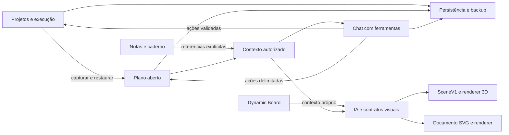

# Catálogo dos módulos

As fichas abaixo foram revisadas contra código e testes disponíveis em 10/10/2026. **Implementado** indica caminho no código, não eficácia científica nem integração remota verificada nesta rodada. **Experimental** indica protocolo/protótipo delimitado. **Proposto** indica trabalho ainda não entregue.

| Módulo | Estado e finalidade | Ficha |
| --- | --- | --- |
| Projetos, planos e execução | Implementado: objetivo, árvore, premissas, critérios, evidências, revisão, Kanban/Scrum e fontes | [Planner e projetos](planner-projects.md) |
| Estúdio 3D | Implementado: cenas validadas, geração modular e decomposição documentada; montagem experimental tem contrato próprio | [3D](three-studio.md) |
| Diagramas interativos | SVG declarativo implementado; React gerado experimental | [Diagramas](diagrams.md) |
| Referências de imagem | Implementado: pesquisa contextual, seleção, ingestão e vínculos; comparação documental limitada | [Imagens](image-references.md) |
| Dynamic Board | Implementado: quadro independente, texto, desenho, imagens e geração visual | [Board](dynamic-board.md) |
| Notas | Implementado: biblioteca com agrupamento por projeto, editor, tinta livre sobre o texto e caderno opcional | [Notas](notes.md) |
| Tinta e sincronização entre dispositivos | Implementado localmente: cinco instrumentos compartilhados, prévias cifradas por SSE e atualização de documentos com revisão CAS; depende da mesma conta/cofre aberto | [Tinta e sincronização](ink-live-sync.md) |
| Chat e Dairo | Chat de ações implementado; Dairo com memória estratégica e resumos diários proposto | [Chat e Dairo](chat-and-dairo.md) |
| Orquestração de IA | Implementado: contexto delimitado, provedores, ferramentas e classificação consultiva | [IA](ai-orchestration.md) |
| Dados e privacidade | Implementado: stores, adaptadores, cloud/cofre e backup; limites de conta/recuperação explícitos | [Dados](data-and-privacy.md) |
| Plataforma e entrega | Implementado: Node, Auth, Railway e PWA; offline completo e escala horizontal não entregues | [Plataforma](platform-and-delivery.md) |

## Como os módulos conversam

O desenho mostra relações de domínio, não cada import. Board e notas reaproveitam contratos/renderizadores, mas mantêm contextos e documentos próprios. O chat atual não possui ferramenta de edição do Board. Referência é identidade/contexto selecionado; cópia é conteúdo independente. Nenhuma dessas relações implica sincronização de cópias ou controle físico do robô.

## O que cada ficha entrega

Cada ficha identifica finalidade e fluxo de uso, arquivos proprietários, contratos de entrada/saída, dados persistidos e temporários, integrações, testes disponíveis, limites e perguntas de pesquisa. Fontes de código e testes são links verificáveis. Os [resultados da revisão](../reports/repository-review-2026-10-10.md) distinguem verificações executadas de verificações apenas disponíveis.

Para ampliar um módulo, começar por seu domínio e seus contratos. Para criar outro, definir proprietário de dados, contexto, cancelamento, aplicação e exportação. Consultar o [mapa de pastas](../repository-map.md) e a [arquitetura](../architecture.md) antes de acrescentar um store ou componente compartilhado.
