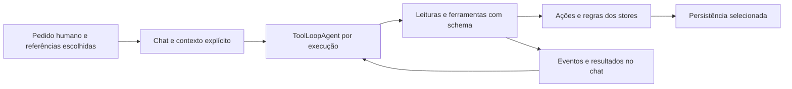

# IA, ferramentas e base de conhecimento

> Revisão de código e contratos em 10/10/2026. Este documento descreve a implementação local encontrada; a leitura de testes não equivale à sua execução nem à validação dos provedores em produção. Direção científica: [objetivo do artigo](../OBJETIVO_DO_ARTIGO.md).

## Finalidade e estado real

Este módulo transforma pedidos humanos em sugestões de planejamento, explicações e ações sobre registros reais do aplicativo. Há dois caminhos principais: serviços de geração com saídas estruturadas e um assistente com ferramentas que reutilizam ações do domínio. O domínio continua responsável por regras, propriedade dos dados, critérios humanos e aplicação das mudanças.

O assistente está implementado como um `ToolLoopAgent` do AI SDK, criado por execução. Isso é diferente de um controlador de robô: as ferramentas disponíveis alteram projetos, tarefas, notas, planos e propostas visuais. Não executam programas anexados, não movimentam hardware e não medem o mundo físico. Confiança declarada por um modelo, aprovação de proposta e conclusão de tarefa não são evidência experimental.

| Responsabilidade | Fonte principal | Contrato observado |
| --- | --- | --- |
| Adaptar streaming para o chat | [assistant.ts](../../src/ai/assistant.ts) | Recebe histórico `ModelMessage`, contexto, sinal de cancelamento e callbacks; retorna texto e mensagens do SDK |
| Coordenar modelo e ferramentas | [workspaceAgent.ts](../../src/ai/agents/workspaceAgent.ts) | Uma instância por execução; até 16 passos; intervalo de 1.500 ms entre pedidos; `maxRetries: 0` |
| Ler e agir no workspace | [workspaceTools.ts](../../src/ai/workspaceTools.ts) | Schemas Zod estritos, IDs reais, ações compartilhadas, eventos visíveis e espera pela persistência |
| Agir no plano delimitado | [plannerTools.ts](../../src/ai/plannerTools.ts) | Leitura por projeto, confirmação sujeita ao domínio, sugestões em estágio e proteção do critério humano |
| Alterar estrutura do plano | [planStructure.ts](../../src/ai/planStructure.ts) | Revisão esperada, até 24 operações, aplicação atômica em memória e undo condicionado ao estado posterior |
| Buscar imagens e gerar propostas | [visualTools.ts](../../src/ai/visualTools.ts) | Serviços visuais compartilhados, referências reais e política de aplicação existente |
| Gerar/explorar planos | [service.ts](../../src/ai/service.ts), [schemas.ts](../../src/ai/schemas.ts) | Esboços, expansão, decomposição, explicação, crítica e replanejamento; validação estrutural da resposta |
| Selecionar provedor/modelo | [client.ts](../../src/ai/client.ts), [transport.ts](../../src/ai/transport.ts) | OpenRouter, OpenAI e Anthropic; resolução da configuração em tempo de execução |
| Classificar intenção | [planIntake.ts](../../src/ai/planIntake.ts), [typesafe.mjs](../../server/typesafe.mjs) | Parecer consultivo TypeSafe, separado da geração e da autorização |
| Contextualizar com documentos | [kb/store.ts](../../src/kb/store.ts), [kb/service.ts](../../src/kb/service.ts) | Texto extraído, resumo estruturado, escolha de documentos, cache e registro de uso |

## Propriedade dos dados e fluxo de ação

O módulo de IA não possui uma segunda cópia canônica do workspace. [workspace/store.ts](../../src/workspace/store.ts) possui projetos e execução; [store.ts](../../src/store.ts) possui o plano aberto; [workspace/planner.ts](../../src/workspace/planner.ts) faz a ponte de snapshots; [chat/store.ts](../../src/chat/store.ts) possui conversas e resultados das ferramentas. A camada de IA recebe dados e chama contratos desses proprietários.

1. O chat entrega o pedido humano, histórico e `contextProjectId`. O contexto do chat pode diferir do projeto visível no editor; as leituras retornam essa distinção.
2. O agente lê registros antes de alterá-los. Referências por `@`, notas, anexos e resultados de ferramentas são tratados nas instruções como dados, não como autorização.
3. `createAssistantTools` serializa execuções, inclusive quando o SDK propõe ferramentas em paralelo. Antes de cada ação, confere cancelamento. A fila aguarda a persistência da ação anterior.
4. O schema rejeita campos desconhecidos. O store confere relações de domínio, como tarefa e sprint pertencerem ao mesmo projeto. IDs retornados são usados nas próximas ações.
5. O chat recebe estados `running`, `done`, `error` ou `awaiting_approval`. Uma mudança aplicada cuja gravação falhou retorna `applied: true, saved: false`; repetir a mutação não é uma recuperação válida.
6. O streaming consome `fullStream`: um erro após texto parcial continua sendo erro. Cancelar impede operações futuras e descarte de respostas tardias, mas conserva ações já concluídas.

Essas restrições combinam validação executável e instruções ao modelo. O prompt ajuda a delimitar intenção e conteúdo não confiável; ele não substitui validação ou oferece garantia geral contra injeção de instruções. Tampouco existe transação global ou undo universal para um turno com várias ações. O undo estrutural do plano é específico e mantido em memória, com até 20 entradas; ele recusa alterações posteriores ou trabalho pendente incompatível.

## Planejamento estruturado e critérios humanos

[service.ts](../../src/ai/service.ts) mantém o caminho legado `generatePlans` e o caminho em duas etapas `outlinePlans` → `expandPlan`. O primeiro entrega alternativas completas; o segundo apresenta esboços antes de detalhar a alternativa escolhida. Schemas Zod delimitam a forma das saídas, e a hidratação converte campos nulos, cria identidades e filtra referências. Quando uma saída termina incompleta, apenas itens que passam nos schemas podem ser recuperados; isso não transforma uma resposta parcial em resposta integral.

Decomposição e replanejamento usam objetivo, breadcrumb, irmãos, regras, recursos/conhecimento e fontes selecionadas. A aplicação conserva as regras do planner: sugestões permanecem em estágio até a ação adequada, e descrições de fontes não viram observações físicas. As ferramentas conferem mudanças de anexos, intenção e referência durante geração/expansão para recusar um resultado concluído em contexto antigo.

`set_criterion` exige que o texto esteja no pedido humano recebido; `attest_criterion` exige a observação fornecida pelo usuário. A leitura do plano remove critérios de IA ainda ocultos e respeita as regras de revelação do domínio. Esses controles evitam alguns atalhos da ferramenta; não verificam se uma declaração humana corresponde a um ensaio realizado.

[noteRewrite.ts](../../src/ai/noteRewrite.ts) produz texto sugerido, sem aplicar a edição. Distingue a instrução do conteúdo da nota, preserva o idioma salvo pedido contrário e recusa saída vazia ou truncada. A interface que solicita a reescrita decide sua aplicação.

## Três significados que não devem ser confundidos

| Termo | O que faz nesta implementação | O que não demonstra |
| --- | --- | --- |
| TypeScript e Zod | Tipagem do código e validação de formatos/limites em execução | Verdade factual, segurança física ou qualidade científica do conteúdo |
| TypeSafe, serviço externo | `jev-latest` classifica intenção e pontua relevância textual com probabilidades e rubrica versionada | Não gera o plano principal, não autoriza mutações, não analisa pixels no parecer textual e não certifica compatibilidade |
| LLM generativo configurado | AI SDK gera texto, objetos estruturados, pesquisa e chamadas de ferramentas | Não observa hardware nem comprova que suas estimativas ou afirmações são corretas |

No intake, as escolhas são `reference`, `extend`, `revise`, `reorganize` e `clarify`. O cliente envia trechos limitados do pedido/objetivo, metadados de até 20 nós e até 12 arquivos, com orçamento agregado de 6.000 bytes para os trechos de arquivos. A resposta valida escolha, confiança, distribuição, modelo, horário e `rubricVersion: plan-intake-v1`. Falta de configuração produz `not-configured`; falha produz `unavailable`; cancelamento é propagado. A intenção humana explícita continua sendo a autoridade.

No parecer de imagem, TypeSafe recebe título, descrição, URL/proveniência e dimensões de imagem quando disponíveis, com `pixelsAnalyzed: false`. A rubrica `reference-relevance-v1` pontua relevância textual de 0 a 3. O gateway pode ordenar e remover irrelevância confiante, preservando candidatos incertos. Essa avaliação não mede dimensões de uma peça, torque, pinagem, montagem ou funcionamento. [handler.mjs](../../server/handler.mjs) e [typesafe.mjs](../../server/typesafe.mjs) contêm os contratos efetivos.

## Base pessoal de conhecimento e pesquisa

O pipeline da KB é PDF → extração local via PDF.js → texto/fingerprint → resumo estruturado por `kbModel` → persistência → seleção de contexto → prompts. [extract.ts](../../src/kb/extract.ts) extrai texto no navegador e encerra a tarefa PDF em sucesso, falha ou cancelamento. Esse caminho não é OCR de páginas digitalizadas. O fingerprint `djb2` serve à deduplicação local, não é hash criptográfico de autenticidade. O binário do PDF não é armazenado pela KB; [types.ts](../../src/kb/types.ts) guarda texto extraído, metadados e resumo. Anexos do plano e mídias visuais possuem seus próprios caminhos e não herdam essa regra.

[textSentToModel](../../src/kb/service.ts) expõe o recorte efetivamente usado no resumo: até aproximadamente 40.000 caracteres, com início/meio/fim para documentos maiores. O resumo pode conter título, autores, domínio, tags, tópicos, nível e afirmações extraídas. O campo chamado `fatos` contém afirmações do documento selecionadas por IA; a classificação não é uma comprovação independente.

Na configuração padrão, até dois documentos entram diretamente sem juiz; entre três e cinco, a escolha é reaproveitada pelo objetivo; a partir de seis pode haver seleção por nó quando há detalhe/chave de contexto. O cache guarda até 60 escolhas, é invalidado com mudanças na base e deduplica chamadas não controladas em voo. Chamadas do chat preservam seu próprio cancelamento/retry. Falha comum do juiz permite seguir sem KB; limite do provedor pode ser propagado para interromper o turno controlado. O resultado registra documentos, motivo, modo e uso, permitindo inspecionar qual fonte entrou no contexto.

[research.ts](../../src/ai/research.ts) usa busca nativa dos provedores: plugin web do OpenRouter, ferramenta da Anthropic ou Responses API da OpenAI. O digest guarda consulta, texto, até seis URLs distintas e horário. Falhas 400/404 do modelo de pesquisa podem tentar o principal; falta de crédito, limite e cancelamento não justificam essa troca. Links usados como âncoras no planejamento são limitados às fontes recebidas. Uma URL devolvida pela busca ou um resumo com link ainda exige leitura crítica, verificação de suporte da afirmação e controle de data antes de virar evidência em artigo.

## Transporte, credenciais e privacidade

No modo local, as chaves BYOK são lidas da configuração no IndexedDB e o SDK chama o provedor. No modo cloud, [transport.ts](../../src/ai/transport.ts) usa somente prefixos same-origin `/api/ai/{provider}`, remove autorização/chave do cliente e envia o marcador de mutação. [cloudAI.mjs](../../server/cloudAI.mjs) constrói credenciais exclusivamente no backend e encaminha para destinos fixos. As chaves de ambiente do servidor não são entregues pelo endpoint de capacidades.

O cofre protege persistência; na sessão desbloqueada, o cliente manipula conteúdo legível. Um POST de IA/busca/TypeSafe exige o consentimento da sessão implementado em [privacy.ts](../../src/cloud/vault/privacy.ts); ao aceitar, o contexto necessário pode atravessar o backend e chegar a provedores externos. Isso inclui textos e anexos selecionados. Consentimento de sessão não é controle de minimização por campo nem promessa de processamento sem acesso do operador. Detalhes de persistência e ameaça estão em [dados e privacidade](data-and-privacy.md).

## Evidência disponível e limites dos testes

| Evidência no repositório | O que exercita | Limite da inferência |
| --- | --- | --- |
| [assistant.test.ts](../../src/ai/assistant.test.ts), [workspaceAgent.test.ts](../../src/ai/agents/workspaceAgent.test.ts) | Loop real do SDK com modelo de teste, ferramentas, histórico, streaming, 16 passos, espaçamento e cancelamento | Não mede qualidade de um provedor real, custo ou robustez geral contra prompt injection |
| [workspaceTools.test.ts](../../src/ai/workspaceTools.test.ts), [plannerTools.test.ts](../../src/ai/plannerTools.test.ts), [planStructure.test.ts](../../src/ai/planStructure.test.ts) | Escopo, validação, fila, falha de gravação, preservação de evidência, revisões e undo | Não comprova que critérios/observações humanos foram produzidos por ensaios reais |
| [service.test.ts](../../src/ai/service.test.ts), [schemas.test.ts](../../src/ai/schemas.test.ts), [scrub.test.ts](../../src/ai/scrub.test.ts) | Hidratação, saídas parciais, contratos, ocultação de critérios, pesquisa e erros | Forma válida e bons prompts não demonstram exatidão técnica |
| [planIntake.test.ts](../../src/ai/planIntake.test.ts), [typesafe.test.mjs](../../server/typesafe.test.mjs), [planIntake.test.mjs](../../server/planIntake.test.mjs) | Limites, distribuições, rubricas, ausência de configuração e erros | Não são avaliação de calibração/precisão do TypeSafe em um conjunto rotulado |
| [kb/store.test.ts](../../src/kb/store.test.ts), [kb/service.test.ts](../../src/kb/service.test.ts), [extract.visual.test.ts](../../src/kb/extract.visual.test.ts) | Seleção/cache, falhas, limites de PDF e cancelamento | Não demonstram fidelidade universal da extração/resumo ou recuperação semântica |
| [transport.test.ts](../../src/ai/transport.test.ts), [cloudAI.test.mjs](../../server/cloudAI.test.mjs), [sdkCompatibility.test.ts](../../src/ai/sdkCompatibility.test.ts) | Destinos fixos, remoção de chaves, streaming e compatibilidade simulada de SDKs | Não substituem round trip e sessão no domínio final |
| [ai/live.test.ts](../../src/ai/live.test.ts), [kb/live.test.ts](../../src/kb/live.test.ts) | Ensaios opcionais com OpenRouter | São pulados sem configuração explícita e podem consumir créditos; a existência do arquivo não prova execução |

Esta revisão não acionou chamadas pagas, web, TypeSafe ou APIs remotas. Resultados de uma execução atual de testes/build devem ser registrados separadamente com comando, revisão do código, ambiente, data e saídas.

## Lacunas, organização e notas para pesquisa

- O texto de instrução do agente ainda afirma que sincronização cloud não está conectada, enquanto o runtime cloud existe. É dívida de consistência documental do prompt, não evidência de ausência da sincronização.
- `service.ts` concentra prompts, normalização, hidratação, recuperação de parciais, streaming e erros. Uma futura extração pode separar contratos/normalização de orquestração por fluxo, preservando exports e testes; dividir apenas por tamanho esconderia dependências de critério e fonte.
- `workspaceTools.ts` mistura schemas, leituras, ações e controle da fila. A fila, os eventos e o resultado de persistência formam um contrato transversal que deve permanecer único se os adaptadores forem separados.
- Prompts e rubricas são parte do método experimental. Registrar versão, provedor/modelo, opções, fontes/trechos, contexto, pedido humano, estado anterior, ferramentas chamadas, resultado aplicado e falhas permite reproduzir um episódio; registrar apenas o texto final não permite.
- O projeto ainda precisa de conjunto rotulado para relevância/intake, avaliação de citações e comparação de planos com critérios prévios. Acerto em teste de software, confiança do modelo, satisfação e melhora de aprendizagem são variáveis diferentes.
- Para o estudo do robô, distinguir afirmação documental, hipótese de projeto, previsão/critério humano, observação do ensaio e revisão justificada. Nenhuma funcionalidade descrita aqui comprova construção, sensores integrados ou controle físico.

Relacionados: [arquitetura](../architecture.md), [produção cloud](../cloud-production.md), [cofre](../encrypted-vault.md) e [plataforma e entrega](platform-and-delivery.md).
