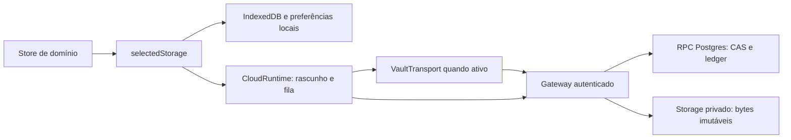

# Dados, persistência, transferência e privacidade

> Revisão local em 10/10/2026. As descrições abaixo são sustentadas pelo código e pelos testes indicados. O estado de uma conta, implantação, bucket ou migration remota não foi consultado nesta revisão. [encrypted-vault.md](../encrypted-vault.md) registra evidências operacionais anteriores e seus limites; isso não é uma nova certificação da produção.

## Finalidade e estado real

A camada de dados conserva os documentos do aplicativo, ordena gravações, permite transferência e explicita falhas de sincronização. Há um modo local, um modo remoto sem cofre e um modo remoto com cifra no cliente. Eles compartilham ações de domínio e formatos de envelopes, mas possuem fronteiras de privacidade diferentes.

Supabase não é o gateway de geração de IA: oferece Auth, Postgres/RPC e Storage. Node/Railway compõe autenticação, autorização, APIs e proxy. O navegador possui os stores e, quando há cofre desbloqueado, a capacidade de decifrar os dados. A divisão de entrega e os endpoints estão em [plataforma e entrega](platform-and-delivery.md).

## Proprietários e contratos

| Dados | Proprietário de domínio | Persistência/contrato |
| --- | --- | --- |
| Plano aberto, nós, critérios, evidências e sugestões | [store.ts](../../src/store.ts) | `cellproject-graph`; snapshots conectados ao workspace pela ponte do planner |
| Projetos, tarefas, sprints, notas, pastas, comentários e quadros | [workspace/store.ts](../../src/workspace/store.ts) | `cellproject-workspace`; quadros/cadernos pertencem aos registros do workspace |
| Histórico e resultados do chat | [chat/store.ts](../../src/chat/store.ts) | `dynamic_diary-chat`, separado do workspace |
| Texto extraído/resumo/cache de escolha da KB | [kb/store.ts](../../src/kb/store.ts) | `cellproject-kb`; não armazena o binário PDF nesse caminho |
| Preferências de provedor/modelo e interface | [config/store.ts](../../src/config/store.ts), [cloud/storage.ts](../../src/cloud/storage.ts) | Config/locale em envelopes; tema, sidebar e visão de tarefas em strings de preferência |
| Envelopes sem ações de domínio | [workspaceRepository.ts](../../src/data/workspaceRepository.ts) | `load/save/remove` preservam a string exata; não reinterpretam o workspace |
| Gravação remota e rascunhos | [runtime.ts](../../src/cloud/runtime.ts) | `CloudSnapshot`, fila, revisão, `operationId`, status e bytes de mídia |
| Cifra e acesso por senha/aparelho | [cloud/vault](../../src/cloud/vault/crypto.ts), [passwordAccess.ts](../../src/cloud/vault/passwordAccess.ts) | `VaultSession`, `VaultTransport`, chave não extraível em IndexedDB e recuperação cifrada pela senha da conta |

As nove chaves aceitas são `cellproject-workspace`, `cellproject-graph`, `dynamic_diary-chat`, `cellproject-kb`, `cellproject-config`, `cellproject-locale`, `dynamic_diary-theme`, `dynamic_diary-sidebar-collapsed` e `dynamic_diary:task-view`. A lista é fechada no [cliente](../../src/cloud/runtime.ts) e no [servidor](../../server/cloudValidation.mjs); adicionar uma chave exige atualizar o contrato e a transferência, não apenas criar um store.

## Seleção de backend e propriedade canônica

[main.tsx](../../src/main.tsx) inicia `CloudBootstrap` antes de importar os stores da aplicação. [CloudBootstrap.tsx](../../src/cloud/CloudBootstrap.tsx) consulta configuração, autenticação, eventual configuração obrigatória de senha e snapshot/cofre. Somente depois seleciona o adaptador e importa a aplicação. Uma falha cloud não abre automaticamente o legado local. O modo local só é selecionado depois de uma resposta explícita `enabled: false`.

Quando a configuração fornece `passwordProvider`, [passwordAuth.ts](../../src/cloud/passwordAuth.ts) envia a senha diretamente ao Supabase Auth e entrega ao Node o par de tokens para validação, rotação e criação do cookie opaco. A senha fica temporariamente no formulário e, durante a abertura do cofre, na chamada de `PasswordVaultGate`; não é gravada nos documentos nem enviada às rotas de senha do Node. Com cofre habilitado, essas rotas legadas recusam clientes antigos com HTTP 426. A URL e a chave publicável do projeto Auth são públicas; chaves administrativas e de provedores de IA continuam fora do cliente.

| Modo selecionado | Onde ficam documentos e mídias | O que permanece no navegador | Consequência |
| --- | --- | --- | --- |
| Local | IndexedDB via `idb-keyval`; preferências simples em localStorage; mídia em store próprio | Conteúdo e chaves BYOK do perfil local | Sem isolamento criptográfico dos dados locais; limpar o site pode apagar a única cópia |
| Cloud sem cofre | Envelopes em Postgres e bytes privados em Storage por gateway | Stores, rascunhos/fila e cache de mídia em memória | Conteúdo chega legível ao backend/persistência; não há fila cloud durável offline |
| Cloud com cofre | Manifesto e blobs cifrados antes do envio | Conteúdo aberto em memória; `CryptoKey` não extraível, recuperação/preparação cifradas em IndexedDB | Armazenamento remoto não recebe os campos privados legíveis; cliente/dispositivo continuam pontos de confiança |

[selectedStorage](../../src/cloud/storage.ts) encaminha leituras e gravações conforme a seleção. O repository do workspace preserva o envelope Zustand, sem possuir as ações de domínio. No modo cloud, preferências também passam pelo runtime; o legado IndexedDB/localStorage não é apagado nem sobrescrito automaticamente. A chave de dispositivo do cofre é uma exceção explícita à política de não persistir documentos cloud no navegador.

## Pipeline de escrita, conflitos e mídia

`CloudRuntime` distingue valor confirmado, rascunho e operação em fila. A escrita é serializada por revisões confirmadas; rascunhos adjacentes ainda não enviados podem ser condensados. Uma operação que pode ter chegado ao servidor mantém corpo, revisão base e `operationId`. Retry de uma resposta perdida reusa a mesma identidade. `flush()` só termina com sucesso quando a fila está confirmada; conflito 409 preserva o rascunho e impede sobrescrita automática pelo relógio local.

Uma sessão expirada suspende a fila. [resumeAfterAuthentication](../../src/cloud/runtime.ts) verifica a mesma conta antes de retomá-la e preserva conflitos. O runtime mantém rascunhos em memória: recarregar/fechar sem confirmação ou resgate pode perdê-los. A PWA não cria uma fila durável de sincronização.

No contrato sem cofre, `PUT /api/cloud/documents/:key` envia `{value, baseRevision, operationId}`. `POST /api/cloud/import` publica documentos por uma RPC atômica, recusando documentos existentes divergentes. [cloudRepository.mjs](../../server/cloudRepository.mjs) usa chave publicável e JWT do usuário em chamadas Supabase; não usa chave administrativa para as operações de documentos. CAS e ledger estão no SQL versionado em [migrations](../../supabase/migrations/20261010043955_cellproject_cloud_persistence.sql).

Mídias seguem fluxo separado: validar bytes/metadados → calcular SHA-256/caminho → upload imutável → leitura integral e conferência → registrar catálogo por RPC. Nome fornecido pelo usuário não vira caminho. O catálogo resolve propriedade; uma leitura confere novamente tamanho/hash. Storage e Postgres não constituem uma única transação: upload interrompido pode deixar objeto órfão. Exclusão remove referência de catálogo/manifesto, e não promete apagamento imediato de bytes ou backups.

Limites relevantes do modo sem cofre: documento até 32 MiB UTF-8, importação de valores até 64 MiB, arquivo até 10 MiB e imagem até 5 MiB. Quotas de catálogo são 50 MiB por projeto e 500 MiB por conta. Os limites completos e suas margens de transporte estão em [cloud-production.md](../cloud-production.md) e nos [validadores](../../server/cloudValidation.mjs).

## Cofre implementado e fronteira de confiança

O cofre não é só uma tela de senha. [crypto.ts](../../src/cloud/vault/crypto.ts) implementa envelope encryption: chave de dados aleatória de 256 bits; AES-GCM com nonce aleatório de 96 bits e tag de 128 bits; duas cópias protegidas da chave por frase e recuperação. PBKDF2-HMAC-SHA-256 usa 600.000 iterações e salt de 128 bits. AAD vincula conta, cofre, versão e finalidade; o manifesto também vincula revisão, e cada mídia usa UUID opaco.

O fluxo atual de [PasswordVaultGate.tsx](../../src/cloud/PasswordVaultGate.tsx) usa **a mesma senha da conta** para abrir os dados em outro aparelho. [passwordAccess.ts](../../src/cloud/vault/passwordAccess.ts) acrescenta uma cópia da recuperação protegida por senha, com PBKDF2-HMAC-SHA-256, 600.000 iterações e AES-GCM; o cabeçalho canônico e a chave de dados existentes permanecem iguais. O servidor armazena esse envelope opaco com revisão CAS, `operationId` e `expectedOwnerId`, sem receber a senha ou a recuperação aberta.

Um aparelho já autorizado pode vincular a senha ao cofre existente. Outro aparelho precisa desse vínculo e da senha; sem vínculo e sem chave local, a interface pede que a pessoa abra primeiro um aparelho autorizado. A ativação inicial grava e confere a chave de dispositivo antes de publicar o cofre. Frase separada e [VaultGate.tsx](../../src/cloud/VaultGate.tsx) pertencem ao caminho legado/fallback, não à entrada principal atual; o formato antigo continua preservado, sem reiniciar as chaves para simplificar o acesso.

A criação/redefinição por link temporário passa por [passwordSetup.ts](../../src/cloud/vault/passwordSetup.ts): com cofre existente, exige a chave de um aparelho autorizado e prepara a nova proteção antes de alterar Auth. Depois confirma o envelope da nova senha. Se Auth mudar e a confirmação do envelope falhar, a interface mantém o acesso do aparelho e permite concluir novamente. Redefinir apenas a credencial Auth não recupera, por si só, dados antigos sem a senha anterior ou um aparelho autorizado.

[deviceKeys.ts](../../src/cloud/vault/deviceKeys.ts) guarda um `CryptoKey` não extraível por structured clone, com vínculo a owner/cofre/fingerprint do cabeçalho, probe autenticado e recuperação cifrada. Antes de ativar remotamente, grava, lê de volta, abre o probe e confere a recuperação/preparação. Falha de IndexedDB impede ativação. A preparação cifrada preserva corpo e ID após resultado ambíguo/reload; gerar outra chave antes de resolver a tentativa anterior seria perda de acesso.

Na abertura, o bootstrap primeiro verifica conta autorizada e cabeçalho remoto. `PasswordVaultGate` confere a chave lembrada e o vínculo de senha, abre o manifesto e o bootstrap verifica a conta novamente antes de importar os stores. Logout/fechamento descartam chaves e caches em memória sob controle da aplicação, conservando a chave lembrada do perfil para o próximo login. Isso não é bloqueio criptográfico independente do login nem apagamento garantido de todas as cópias da memória JavaScript.

| Fronteira | Proteção existente | Limite explícito |
| --- | --- | --- |
| Banco, Storage e tráfego de persistência com cofre | Documentos, nomes, MIME, IDs privados, relações e hashes originais dentro da cifra | Conta, ID público do cofre, salt/KDF, revisões, horários, volumes e hashes cifrados continuam visíveis |
| Perfil do navegador | Handle AES não extraível; recuperação/preparação cifradas | Código autorizado no mesmo perfil pode usar a chave; não há promessa de proteção por hardware |
| Cliente aberto | Stores legíveis para editar/renderizar | XSS, extensões, dispositivo comprometido ou versão maliciosa do cliente podem acessar conteúdo/chave em uso |
| Operador que publica o app | Backend não recebe chave para abrir armazenamento cifrado | Quem controla futuras versões do cliente pode mudar o código; não há garantia absoluta contra esse operador |
| IA/busca/TypeSafe | [privacy.ts](../../src/cloud/vault/privacy.ts) exige consentimento no primeiro POST da sessão desbloqueada | Aceitar compartilha contexto necessário com servidor e provedores; cifra de armazenamento não cobre esse processamento |
| Histórico anterior à ativação | Migração retira documentos legados atuais atomicamente | Logs, exports, PITR e backups antigos não se tornam retroativamente secretos |

[VaultTransport](../../src/cloud/vault/transport.ts) adapta as rotas legadas em memória: stores veem envelopes normais, a rede vê manifesto/blobs cifrados. Ele serializa mutações, resolve commits ambíguos antes da próxima operação e reutiliza a mesma cifra e UUID no retry. Respostas confirmadas têm janela FIFO de 128 respostas/512 KiB; recibos/fingerprints compactos continuam na sessão. Operações ambíguas e respostas fixadas aguardando consumo não são podadas. Isso reduz retenção pesada, mas não limita toda a memória a 512 KiB.

O manifesto cifrado aceita até 96 MiB, com transporte até 130 MiB; blobs cifrados até 15 MiB; catálogo cifrado até 700 MiB. Excluir arquivo não libera automaticamente quota nesta versão. Migração de contas com mídia legada exige assistência; ativação recusa catálogo ou objetos antigos em Storage. Esses limites pertencem ao release e não devem ser removidos por uma descrição genérica de “nuvem ilimitada”.

## Backups, transferência e resgate

Há formatos com finalidades distintas:

| Formato | Fonte | Escopo e limite |
| --- | --- | --- |
| `cellproject-workspace-backup` v1 | [workspaceTransfer.ts](../../src/data/workspaceTransfer.ts) | Dados de domínio do workspace; não é backup integral de chat, config e binários |
| `cellproject-workspace-rows` / `cellproject-chat-rows` v1 | [workspaceTransfer.ts](../../src/data/workspaceTransfer.ts) | Exportação pura para linhas com owner e relações; não demonstra uso desse desenho como banco ativo |
| `cellproject-global-backup` v1 em ZIP | [migration.ts](../../src/cloud/migration.ts) | Envelopes, preferências, manifesto e originais; valida SHA-256, formatos, cadernos e quadros |
| `.ddvault` | [privacy.ts](../../src/cloud/vault/privacy.ts) e [migration.ts](../../src/cloud/migration.ts) | Backup/resgate global cifrado por padrão quando protegido; blocos de 16 MiB, AAD por pacote/tipo/índice/quantidade |
| `cellproject-session-rescue` v1 | [rescue.ts](../../src/cloud/rescue.ts) | `complete: false`; documentos atuais e bytes já em cache, com IDs das mídias ausentes |

Importação global valida o pacote antes de enviar, faz preflight de divergências, envia mídia, publica envelopes e verifica round trip. O hash do manifesto não substitui conferência de conteúdo/bytes. Não há remoção automática da origem local. Exportações individuais de texto/JSON/JavaScript continuam legíveis quando solicitadas explicitamente; a extensão `.ddvault` não se aplica a qualquer download da interface.

O backup cifrado contém cabeçalho e blocos suficientes para futura recuperação criptográfica, mas a interface atual só importa com o cofre original desbloqueado. Ainda falta restauração independente/offline após perda de conta/registro remoto. Limpar os dados do site remove a chave local; a reabertura depende da senha e do vínculo remoto existente, ou de outro aparelho autorizado. Cofres legados sem esse vínculo ainda dependem do acesso antigo. Um resgate parcial habilita uma saída excepcional após falha de gravação; não substitui backup global nem resolve mídias ausentes.

[activity.ts](../../src/cloud/activity.ts), [actions.ts](../../src/ai/actions.ts) e [CloudStatus.tsx](../../src/cloud/CloudStatus.tsx) coordenam troca de dados, backup e saída com atividades em andamento. Ingestão conta desde a leitura de arquivos, não somente durante a chamada de IA. Sair protegido aguarda salvamento/logout; falha conserva sessão/rascunhos. A transição excepcional exige resgate baixado explicitamente.

## Evidência de software e limites

| Testes/fixtures disponíveis | Cobertura observável | O que não comprovam |
| --- | --- | --- |
| [workspaceRepository.test.ts](../../src/data/workspaceRepository.test.ts), [storage.test.ts](../../src/cloud/storage.test.ts), [adapters.test.ts](../../src/cloud/adapters.test.ts) | Envelopes exatos, seleção local/remota, ausência de fallback e coalescência | Durabilidade física do disco, quota/eviction do navegador ou serviço remoto |
| [runtime.test.ts](../../src/cloud/runtime.test.ts), [recovery.test.ts](../../src/cloud/recovery.test.ts), [session.test.ts](../../src/cloud/session.test.ts) | CAS, ordem, retry idêntico, mídia, rascunhos e sessão | Disponibilidade/concorrência do Supabase gerenciado |
| [migration.test.ts](../../src/cloud/migration.test.ts), [workspaceTransfer.test.ts](../../src/data/workspaceTransfer.test.ts), [rescue.test.ts](../../src/cloud/rescue.test.ts) | Round trips fabricados, integridade, validação e resgate parcial | Recuperação independente após desastre nem consistência entre vários dispositivos reais |
| [crypto.test.ts](../../src/cloud/vault/crypto.test.ts), [deviceKeys.test.ts](../../src/cloud/vault/deviceKeys.test.ts), [transport.test.ts](../../src/cloud/vault/transport.test.ts) | Adulteração, conta/finalidade/revisão, handles, preparação e commits ambíguos | Auditoria criptográfica independente, resistência de dispositivo comprometido ou proteção por hardware |
| [CloudBootstrap.test.tsx](../../src/cloud/CloudBootstrap.test.tsx), [PasswordVaultGate.test.tsx](../../src/cloud/PasswordVaultGate.test.tsx), [passwordAccess.test.ts](../../src/cloud/vault/passwordAccess.test.ts), [passwordSetup.test.ts](../../src/cloud/vault/passwordSetup.test.ts), [VaultGate.test.tsx](../../src/cloud/VaultGate.test.tsx), [VaultLifecycle.test.tsx](../../src/cloud/VaultLifecycle.test.tsx), [CloudStatus.test.tsx](../../src/cloud/CloudStatus.test.tsx) | Import tardio, vínculo por senha/aparelho, redefinição, bloqueio, cancelamento, troca de geração, logout e resgate | Operação em todos os navegadores/dispositivos nem publicação da versão |
| [privacy.test.ts](../../src/cloud/vault/privacy.test.ts), [backup.test.ts](../../src/cloud/vault/backup.test.ts) | Consentimento e ausência de downgrade legível durante bloqueio | Política de retenção ou uso do contexto por provedores externos |
| [cloudRepository.test.mjs](../../server/cloudRepository.test.mjs), [vaultRepository.test.mjs](../../server/vaultRepository.test.mjs), [cloud-persistence.sql](../../supabase/tests/cloud-persistence.sql), [test-vault-sql.mjs](../../scripts/test-vault-sql.mjs) | Contratos de gateway, RLS/CAS/ledger e fixture PostgreSQL WASM | Fixture isolado não substitui Auth/Storage gerenciados, extensão safeupdate compilada ou agendamento entre conexões reais |

Os resultados atuais das suítes cliente/gateway estão no [relatório desta rodada](../reports/repository-review-2026-10-10.md). SQL isolado, serviços remotos e recuperação independente exigem execuções próprias. O número de verificações de um relatório anterior deve ser acompanhado da revisão e ambiente que o produziram.

## Lacunas e recomendações de organização

- O release é de conta única. Antes de múltiplas contas, `activate/write/blob` precisam receber e validar `expectedOwnerId` no servidor: verificar conta antes de abrir a UI não cobre troca de cookie entre snapshot e POST. Essa lacuna está registrada em [encrypted-vault.md](../encrypted-vault.md) e é observável nos contratos atuais de [vaultRepository.mjs](../../server/vaultRepository.mjs). O envelope adicional de senha já valida `expectedOwnerId` em [passwordAccessRepository.mjs](../../server/passwordAccessRepository.mjs); isso não amplia automaticamente a proteção às outras rotas.
- Sessões, fluxos PKCE, limites e barreira de ativação Node são locais ao processo. Uma réplica é requisito; expansão precisa de coordenação compartilhada, sem confundir o lock SQL com todos os controles de processo.
- `CloudRuntime`, `VaultTransport` e os stores têm responsabilidades de fila diferentes. Modularização futura deve preservar uma fila de gravação por responsabilidade e as invariantes de retry, em vez de criar outro autosave genérico.
- `migration.ts` reúne codecs de backup, validação e importação remota. Separar o formato puro do transporte facilitaria revisão e futura restauração independente; os contratos de mídia e cofre precisam permanecer explícitos.
- Retenção/coleta de órfãos, liberação de quota, restauração independente, rotação de chave/frase e esquecimento seletivo do dispositivo permanecem frentes próprias. Não estão entregues pelo simples uso de AES-GCM ou Storage privado.
- O SQL de [docs/database/workspace-schema.sql](../database/workspace-schema.sql) é desenho relacional histórico, não o mecanismo remoto ativo de envelopes/cofre. Usá-lo como descrição da implementação distorceria o método.

Para pesquisa, registrar modo de persistência, owner pseudonimizado, versões de formato, revisão antes/depois, ID da operação, decisão de consentimento e resultado confirmado sem registrar chaves, senha ou recuperação. Distinguir integridade de transporte, autorização, confidencialidade em repouso, disponibilidade e recuperação: um teste positivo de uma propriedade não valida as demais.
