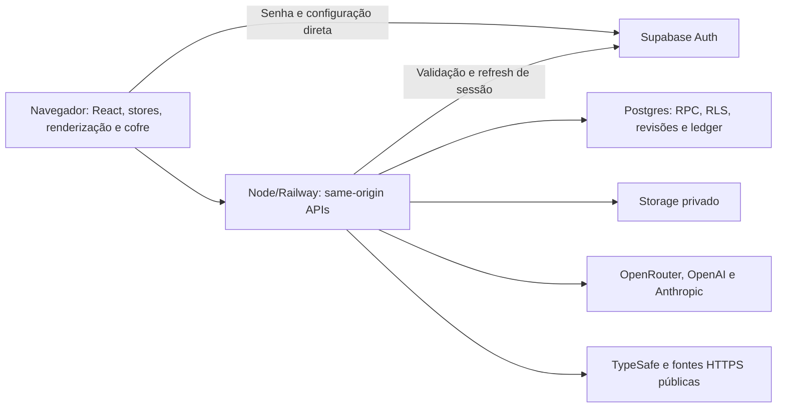

# Plataforma, gateway, PWA e entrega

> Referência do repositório em 10/10/2026. Esta revisão não fez deploy, chamadas externas nem conferência de variáveis privadas. Configuração versionada descreve a intenção de execução; saúde/versão publicadas exigem observação própria. Consulte [cloud-production.md](../cloud-production.md) para o contrato operacional detalhado.

## Finalidade e arquitetura executável

A plataforma entrega uma SPA React/Vite e um servidor Node que serve o build e concentra APIs privadas. O servidor pode ser executado no Railway; Supabase provê identidade, banco e arquivos. O navegador resolve ferramentas, ações de domínio e renderização. Não há Edge Function nesse caminho implementado.

| Camada | Entrada/fonte | Responsabilidade |
| --- | --- | --- |
| Bootstrap do cliente | [main.tsx](../../src/main.tsx), [CloudBootstrap.tsx](../../src/cloud/CloudBootstrap.tsx) | Escolher backend e exigir autenticação/senha/cofre antes de importar dados |
| App | [App.tsx](../../src/App.tsx), [architecture.md](../architecture.md) | Shell, navegação e composição de domínios; conteúdo possui stores próprios |
| Desenvolvimento | [vite.config.ts](../../vite.config.ts) | HMR, aliases, gateway visual local e configuração cloud explicitamente desabilitada |
| Produção | [production.mjs](../../server/production.mjs) | HTTP, arquivos de `dist`, autenticação, repositórios, proxy IA e gateway visual |
| Identidade | [passwordAuth.ts](../../src/cloud/passwordAuth.ts), [cloudAuth.mjs](../../server/cloudAuth.mjs) | Senha diretamente ao Auth, validação/refresh no Node, link PKCE e cookie opaco |
| Persistência | [cloudRepository.mjs](../../server/cloudRepository.mjs), [vaultRepository.mjs](../../server/vaultRepository.mjs) | RPCs autenticadas, documentos, catálogo e blobs |
| IA | [cloudAI.mjs](../../server/cloudAI.mjs) | Destinos fixos, chaves do servidor, limites, streaming e cancelamento |
| Pesquisa visual/documental | [handler.mjs](../../server/handler.mjs), [referenceRegistry.mjs](../../server/referenceRegistry.mjs), [specDocuments.mjs](../../server/specDocuments.mjs) | Capacidades, sessões de referência, mídia, especificações e TypeSafe |
| Instalação/cache público | [pwa/install.ts](../../src/pwa/install.ts), [service-worker.js](../../public/service-worker.js) | Instalação opcional, shell público offline e atualização explícita |

## Superfícies expandidas

Board, notas e mapa do plano usam [ExpandedChrome.tsx](../../src/components/ui/ExpandedChrome.tsx) para ocultar cabeçalhos e controles de navegação ao maximizar. Um botão discreto revela as informações por hover, foco de teclado ou toque. Os controles aparecem sobre o conteúdo, sem faixa reservada nem deslocamento ao abrir. Escape fecha primeiro esse painel; outro Escape no botão restaura a superfície. Campos com tratamento próprio e diálogos conservam a prioridade do atalho.

O wrapper permanece no DOM nos dois modos, mantendo editor, ferramentas portadas, seleção e canvas montados. Conteúdo oculto usa `hidden`, saindo da navegação por Tab. Board e notas ocupam a viewport e permanecem abaixo dos modais; o chat é suspenso durante a expansão. No planejador, o enquadramento deixa de reservar a toolbar oculta, e revelar controles não reenquadra o grafo. Em modo normal, os cabeçalhos conservam o fluxo original.

Regressões: [ExpandedChrome.test.tsx](../../src/components/ui/ExpandedChrome.test.tsx), [BoardCanvas.test.tsx](../../src/boards/BoardCanvas.test.tsx), [Notes.test.tsx](../../src/workspace/Notes.test.tsx) e [GraphCanvas.autoLayout.test.tsx](../../src/components/GraphCanvas.autoLayout.test.tsx). Medidas visuais são verificadas no navegador, pois JSDOM não calcula o layout real.

## Desenvolvimento local e produção são modos distintos

`npm run dev` usa Vite, porta padrão 5173 e HMR. Seu `GET /api/cloud/config` retorna `enabled: false`, selecionando persistência local e BYOK. O gateway visual local continua no processo Vite, com [access.mjs](../../server/access.mjs): endereço remoto loopback, Host/porta locais, Origin/Fetch Metadata compatíveis e cookie de acesso visual de 30 minutos estabelecido pela leitura de capacidades. Abrir um localhost não equivale a autenticar uma conta cloud.

Vite pode semear uma chave de desenvolvimento do ambiente no cliente local por `__DEV_OPENROUTER_KEY__`; na compilação de produção esse valor é vazio. Essa conveniência não deve ser descrita como chave secreta dentro de um bundle de desenvolvimento. Os artefatos de produção não recebem a chave semeada. A disponibilidade real dos provedores é definida pelas capacidades/configuração, não por existir um SDK instalado.

`npm start` executa `server/production.mjs`, carrega `.env` se existir e serve `dist`; exige runtime compatível com a opção Node usada (a documentação operacional estabelece Node 22.9+). O servidor escuta `PORT` ou 3000 em `0.0.0.0`. [railway.json](../../railway.json) especifica Nixpacks, `npm start`, `/healthz`, timeout de 30 segundos, uma réplica e reinício por falha. Isso é configuração, não evidência de que o deploy atual a está usando.

`GET /healthz` devolve `status: ok` sem consultar todas as dependências. Portanto, HTTP 200 desse endpoint comprova que o processo responde; não comprova login, acesso ao banco/Storage, geração de IA ou recuperação de backup.

## Autenticação, allowlist e autoridade do criador

[readCloudConfig](../../server/cloudAuth.mjs) falha fechado com configuração cloud incompatível, exige origem HTTPS canônica, limita o projeto Supabase e mantém um email autorizado fixo. `SUPABASE_ALLOWED_USER_ID` é reforço opcional. O servidor e o banco conferem identidade confirmada, emissor, público/expiração do token e a RPC `cellproject_authorized()`, que consulta allowlist e sessão ativa. `user_metadata` editável não é fonte desse direito.

A conta autorizada do criador pode usar provedores configurados no servidor, mas isso não entrega uma “root key” ao navegador nem concede administração do Supabase. Chaves de OpenRouter/OpenAI/Anthropic/TypeSafe são variáveis somente do backend, sem prefixo `VITE_`, e capacidades retornam booleanos. Repositórios de persistência usam publishable key mais JWT do usuário. [cloudValidation.mjs](../../server/cloudValidation.mjs) recusa credenciais estruturadas dentro de configuração cloud; isso não é um detector geral de segredos escritos pelo usuário em texto livre.

Fluxo principal de acesso:

1. A interface oferece email/senha. Com `passwordProvider`, o navegador envia a senha diretamente ao Supabase Auth e entrega os tokens a `/api/auth/password/session`. Node valida identidade/autorização, prova o vínculo do par por refresh e cria uma sessão opaca. A senha não passa pelo gateway da aplicação nem faz parte dos documentos/logs. As rotas antigas que recebem senha retornam HTTP 426 quando o cofre está habilitado.
2. Para criar/redefinir senha, solicita um link específico de recuperação/PKCE. Somente esse fluxo concede o token temporário de `/api/auth/password/setup-session` para configurar a senha diretamente no Auth; link comum não o concede. A janela é de 15 minutos. Com cofre existente, o cliente exige aparelho autorizado, prepara o novo vínculo cifrado antes de alterar Auth e confirma o vínculo depois.
3. Link de acesso alternativo também usa PKCE. O verifier permanece em memória no servidor; o cookie de fluxo tem apenas handle aleatório e `SameSite=Lax`, permitindo retorno por navegação do email no mesmo navegador.
4. Callback consome o fluxo antes de awaits e, após validação, redireciona para `/`. Falha usa flag fixa, sem propagar código ou erro bruto. Os tokens do login direto e o token temporário de configuração passam pela chamada do cliente; depois da troca, a sessão e o refresh ficam no servidor, sem tokens Supabase no cookie ou persistência pelo formulário.
5. O cookie de sessão `__Host-cellproject_session` é HttpOnly, Secure, SameSite=Strict e Path=/; o handle tem limite absoluto de 30 dias com volume cifrado configurado, ou oito horas no modo legado em RAM. Refresh é serializado; cada API privada revalida identidade/autorização. A chave de autenticação do servidor é distinta da chave dos dados do usuário.
6. Logout remove o handle persistente antes de concluir e tenta revogar a sessão Supabase. Com volume/chave estáveis, sessões normais sobrevivem a reinício/deploy; PKCE e autorização temporária de redefinição de senha continuam efêmeros. A implantação usa uma réplica. O [contrato de produção](../cloud-production.md) descreve a transição inicial e a configuração.

Os formulários de senha mantêm estado transitório e limpam campos ao concluir/trocar modo. Essa propriedade da aplicação não significa que um operador/agente deva receber ou guardar a senha. Nenhuma senha, token ou valor de chave é necessário para compreender os contratos deste documento.

[PasswordVaultGate.tsx](../../src/cloud/PasswordVaultGate.tsx) usa o vínculo cifrado da senha da conta e a chave lembrada do aparelho para abrir o cofre antes de importar os stores. O vínculo preserva a chave de dados existente; um aparelho novo sem vínculo pede primeiro acesso em outro aparelho autorizado. A chave não extraível do perfil permanece após logout. Frase separada e `VaultGate` são compatibilidade legada/fallback. O fluxo de redefinição e seus limites estão em [dados e privacidade](data-and-privacy.md).

## Origem, APIs e arquivos públicos

O domínio canônico fica em `APP_ORIGIN`. Hosts alternativos só redirecionam GET/HEAD públicos quando configurados explicitamente; APIs não redirecionam. Mutações exigem Origin exata, `X-Cellproject-Request: 1` e Fetch Metadata compatível; não há CORS público. O callback GET é uma exceção restrita a navegação para documento, com Host canônico, `no-store` e `no-referrer`.

[production.mjs](../../server/production.mjs) restringe paths, extensões, arquivo real dentro de `dist` e fallback SPA: falhas `/api` não retornam HTML da aplicação. A CSP restringe scripts ao próprio domínio; conexões permitem o próprio domínio e o projeto Supabase Auth validado quando há `passwordProvider`. Permite os workers/WebAssembly necessários e imagens HTTPS/blob/data. APIs privadas usam `no-store`; mídia própria usa attachment, integridade e proteção de MIME. A configuração de logs da infraestrutura precisa omitir query strings de autenticação; código que não imprime o callback não demonstra essa configuração do provedor.

| Prefixo/rota | Contrato de plataforma | Proprietário dos dados/resultado |
| --- | --- | --- |
| `/api/cloud/config` | Capacidades, modo, autenticação e provedor Auth com chave publicável; sem chaves administrativas ou de IA | Bootstrap/configuração |
| `/api/auth/*` | Troca de tokens por sessão, autorização temporária de senha, link/callback e logout | Auth direto no Supabase, sessão opaca no Node |
| `/api/cloud/snapshot`, `/documents/:key`, `/import`, `/media` | Snapshot, CAS/idempotência, import e mídia legada privada | Stores + repositório cloud |
| `/api/cloud/vault*` | Cabeçalho/manifesto/blob cifrado e revisão | Chave no cliente; bytes no repositório do cofre |
| `/api/cloud/vault/password-access` | Vínculo da senha por envelope cifrado, revisão CAS e `expectedOwnerId` | Recuperação aberta apenas no cliente; chave de dados existente preservada |
| `/api/live/ink` | POST/SSE cifrado e efêmero por conta, com backpressure limitado | Prévia temporária; documento salvo continua canônico |
| `/api/ai/*` | Proxy pago para quatro rotas fixas de provedores | Contexto enviado deliberadamente para geração/pesquisa |
| `/api/visuals/*` | Capacidades, referências, mídia, especificações e classificação | Sessões efêmeras por acesso/contexto e resultados selecionados |

Persistência e seus limites estão em [dados e privacidade](data-and-privacy.md). Ter armazenamento cifrado não oculta um pedido de IA autorizado: o backend precisa processar/encaminhar o corpo legível necessário.

## Gateway de IA e fontes públicas

O proxy IA aceita POST apenas nas rotas de chat dos três provedores e Responses da OpenAI. Reconstrói headers, ignora credenciais do cliente e não aceita URL de destino arbitrária. Entradas têm até 24 MiB, até 500 itens quando são arrays, modelo limitado e orçamento de saída até 65.536 tokens; sem orçamento aplica 16.384. Há limite por conta de 40 pedidos/minuto, quatro simultâneos por conta e seis globais; timeout de dez minutos e aborto quando o cliente desconecta. Não há retry automático de chamada paga no backend.

O gateway visual usa registro de candidatos, identidade de acesso e fingerprint do contexto. O cliente pede mídia por sessão/candidato, em vez de transformar qualquer URL em proxy aberto. A avaliação TypeSafe é textual/consultiva e usa chave do servidor; não é validação TypeScript nem ensaio de compatibilidade. [ai-orchestration.md](ai-orchestration.md) detalha essa distinção.

[publicHttps.mjs](../../server/publicHttps.mjs) limita leitura de fontes a HTTPS público na porta 443, rejeita credenciais embutidas/endereços privados, verifica todas as respostas DNS e fixa o endereço na conexão TLS. Até três redirects repetem a validação. Downloads têm limites de bytes/tempo, sem repassar cookies/autorização do usuário. [specDocuments.mjs](../../server/specDocuments.mjs) extrai fontes documentais; extração e relevância não estabelecem a veracidade de uma especificação ou uma medida física.

As sessões de referência e limites vivem em memória. Reinício pode invalidar identificadores efêmeros; uma referência persistida no domínio precisa conservar sua própria proveniência/bytes conforme o serviço de mídia, sem presumir permanência do registry.

Ao usar uma imagem como base 3D, o estúdio registra a entrada pelo contrato `onDraft`. [VisualExplorer.tsx](../../src/visuals/ui/VisualExplorer.tsx) acrescenta a imagem ao rascunho mais recente, preservando texto, anexos e referências. [TabbedVisualExplorer.tsx](../../src/visuals/ui/TabbedVisualExplorer.tsx) inicia uma nova aba com a imagem, sem editar uma aba em execução, e também registra essa entrada. O repasse segue a persistência do domínio, sem depender apenas do estado transitório da janela.

## PWA: instalação, offline e atualização

[manifest.webmanifest](../../public/manifest.webmanifest) define identidade, início/escopo `/`, janela `standalone`, cores e ícones `any`/`maskable`. [InstallApp.tsx](../../src/pwa/InstallApp.tsx) mostra o prompt real quando o navegador fornece `beforeinstallprompt`; caso contrário, oferece instruções de instalação, incluindo Safari/iOS. Aceitar um prompt não é registrado como instalação concluída antes do evento/estado correspondente. Disponibilidade depende do navegador e contexto seguro.

[registerPwa](../../src/pwa/install.ts) só registra o worker no build de produção, em contexto seguro e com suporte do navegador. Desenvolvimento/HMR e chave semeada não são cacheados por esse worker. [buildPlugin.ts](../../src/pwa/buildPlugin.ts) calcula hash a partir dos assets compilados, HTML, worker, manifesto e ícones; injeta revisão e lista de assets públicos no worker gerado.

O servidor entrega o worker registrado em `/service-worker.js` com `Cache-Control: no-cache`; `/sw.js` conserva a mesma regra por compatibilidade. HTML e manifesto também usam `no-cache`, enquanto os assets compilados de `/assets/` usam cache imutável. `updateViaCache: none` complementa esse contrato, sem substituir o header do arquivo real.

O service worker faz precache do shell público com credenciais omitidas. Intercepta assets listados de origem própria e navegação simples para `/`; em falha de navegação pode oferecer esse shell previamente cacheado. Não armazena APIs, anexos, conteúdo do usuário, respostas autenticadas, query strings, navegação de callback ou respostas `private/no-store/opaque`. Conserva uma versão pública anterior para abas que ainda pedem seus chunks.

Consequências práticas:

- Em uma sessão local já aberta, as ações que dependem apenas dos stores/IndexedDB podem continuar sem rede; IA e pesquisa dependem de conexão. Abrir/recarregar offline é diferente: o shell cacheado ainda executa `CloudBootstrap`, que consulta `/api/cloud/config`. Como essa API não é cacheada e não há fallback de configuração, essa abertura pode parar na tela de erro mesmo com documentos locais presentes. O release não entrega inicialização offline completa, nem garante retenção de caches/dados pelo navegador.
- Em modo cloud, carregar o shell não abre uma sessão nem snapshot: `CloudBootstrap` exige rede e não recua para dados locais. O aplicativo informa que é preciso estar conectado. Não há modo cloud offline completo ou sincronização em background.
- O worker novo espera. A UI oferece **Atualizar e reiniciar**; somente o clique envia `ACTIVATE_UPDATE` e recarrega após `controllerchange`. Não há reload automático durante edição. O clique não implementa, por si só, uma transação adicional de flush: o usuário deve terminar o trabalho conforme a interface informa.
- Instalação PWA não transforma o site em aplicativo nativo, não isola o perfil contra extensões e não muda os limites de privacidade do cliente aberto.

## Build, carregamento e verificações disponíveis

[package.json](../../package.json) define `build` como `tsc -b && vite build --config vite.config.ts`; `lint` atualmente significa checagem TypeScript, sem linter estilístico separado. Os comandos de desenvolvimento/build/preview, Vitest e auditoria de bundle selecionam a configuração fonte explicitamente. Vite divide famílias de dependências em chunks (`react`, `xyflow`, `pdf`, `three`, `ai-sdk`, `zod`). Lazy loading evita carregar recursos caros antes da necessidade, mas a prova depende do grafo real, não apenas da presença de `import()`.

[audit-client-bundle.mjs](../../scripts/audit-client-bundle.mjs) compila em memória, percorre imports transitivos do bootstrap/App, calcula bytes/gzip e recusa módulos pesados específicos no caminho inicial: canvas/composer/prévia de quadro, camada de canvas visual e extração PDF. `npm run check:bundle` aplica esse contrato. O script não é uma auditoria universal de dependências, vulnerabilidades, segredos ou performance em dispositivos reais.

| Comando/fonte | Propósito | Limite |
| --- | --- | --- |
| `npm test` / [vitest.config.ts](../../vitest.config.ts) | Testes `src/**/*.test.ts(x)` em jsdom, com ambientes próprios quando declarados | Experimentos sob `docs/design` não entram automaticamente na suíte principal |
| `npm run test:gateway` / [server](../../server/production.test.mjs) | Node test runner para `server/*.test.mjs` | Supabase, email e provedores são simulados |
| `npm run test:all` | Encadear testes do cliente e gateway | Não inclui implicitamente validação remota, SQL isolado ou todas as experiências |
| `npm run build` | Tipagem e compilação produtiva | Não demonstra o fluxo do usuário nem comportamento do deploy |
| `npm run check:bundle` | Contrato de carregamento inicial real | Medidas são do build auditado, não latência real ou consumo de memória |
| [test-vault-sql.mjs](../../scripts/test-vault-sql.mjs) e [cloud-persistence.sql](../../supabase/tests/cloud-persistence.sql) | Fixtures/asserções SQL de autorização e persistência | Precisam de execução própria; isolamento não comprova ambiente gerenciado |

Testes específicos: [production.test.mjs](../../server/production.test.mjs) cobre arquivos/origens/roteamento; [cloudAuth.test.mjs](../../server/cloudAuth.test.mjs) cobre PKCE, senha, revogação e cookies; [cloudAI.test.mjs](../../server/cloudAI.test.mjs) cobre proxy/streaming; [publicHttps.test.mjs](../../server/publicHttps.test.mjs) cobre destinos/redirects; [handler.test.mjs](../../server/handler.test.mjs) cobre gateway visual; [serviceWorker.test.ts](../../src/pwa/serviceWorker.test.ts), [buildPlugin.test.ts](../../src/pwa/buildPlugin.test.ts) e [install.test.ts](../../src/pwa/install.test.ts) cobrem cache/atualização/instalação simulados. Os resultados das suítes, build e auditoria de bundle estão no [relatório desta rodada](../reports/repository-review-2026-10-10.md); instalação real e integração remota continuam exigindo validação própria.

## Lacunas de entrega e organização

- Uma réplica é requisito atual, coerente com sessões, PKCE, rate limits, registry e barreira Node em memória. Escala horizontal requer estado/coordenação compartilhados e teste de concorrência; alterar só `numReplicas` não entrega isso.
- Saúde de produção deve ser separada por propriedade: processo responde; conta autentica; autorização revogada é recusada; documento/mídia completam round trip; streaming cancela; backup restaura. Um status de deploy ou `/healthz` não cobre a lista.
- `production.mjs` é a composição central e roteia muitas responsabilidades. Extrair grupos de rotas pode facilitar leitura se ordem de autenticação, same-origin, no-store, reserva da ativação e descarte forem mantidos e testados como invariantes comuns.
- Os dois modos do gateway visual possuem autoridades distintas: cookie local versus identidade cloud. Um adaptador de acesso explícito já existe; ele deve ser preservado em qualquer separação de roteadores.
- Antes de publicar afirmações de PWA, executar instalação/atualização/offline em navegador real e registrar versão/perfil. Antes de publicar afirmações de privacidade, manter as limitações de cliente aberto, IA, backups antigos e restauração independente.

Para artigos, registrar revisão do código, build, runtime, modo local/cloud/cofre, dispositivo/navegador, rede, provedor/modelo e execução de cada verificação. Métricas de bundle, testes simulados, provas de integração remota e estudo com usuários são evidências distintas e não devem ser somadas como uma única “validação completa”.
