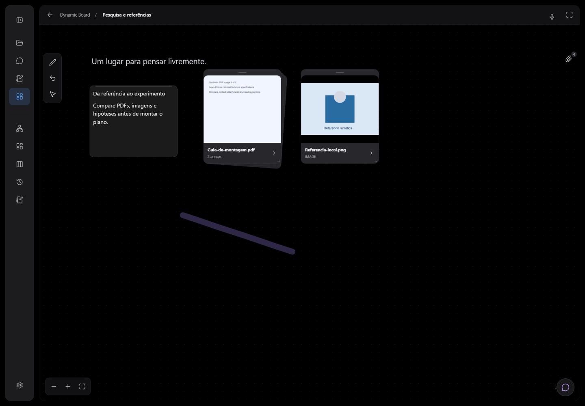
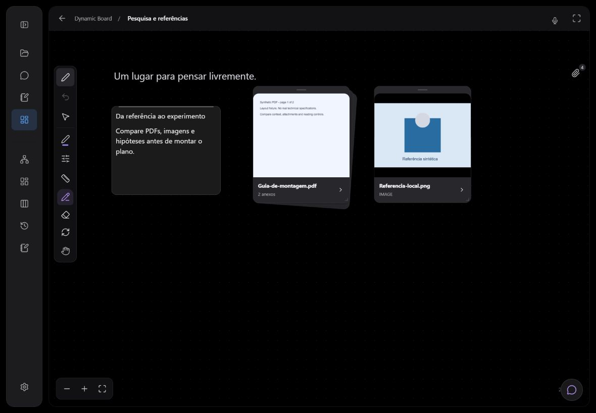
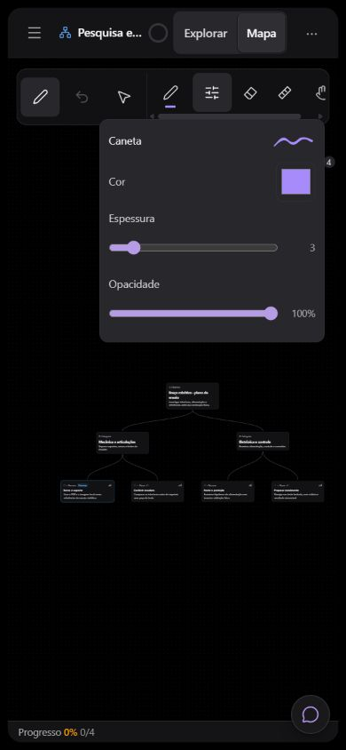
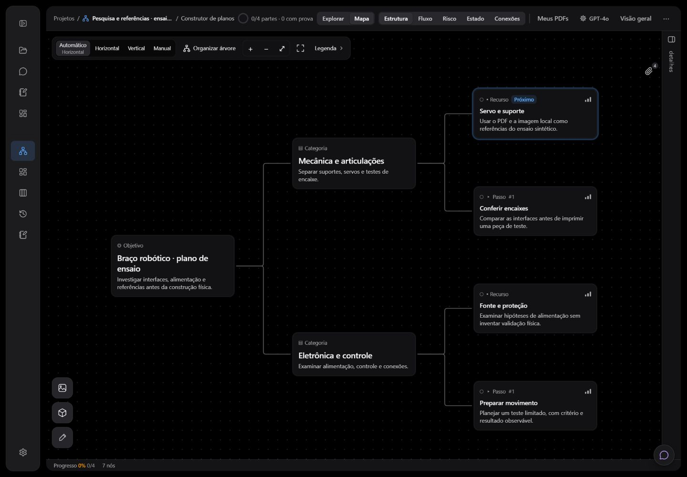
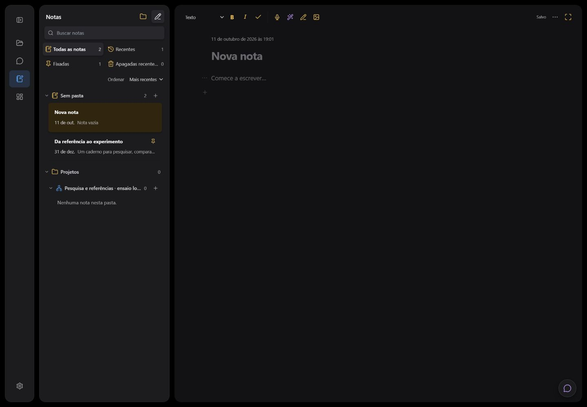
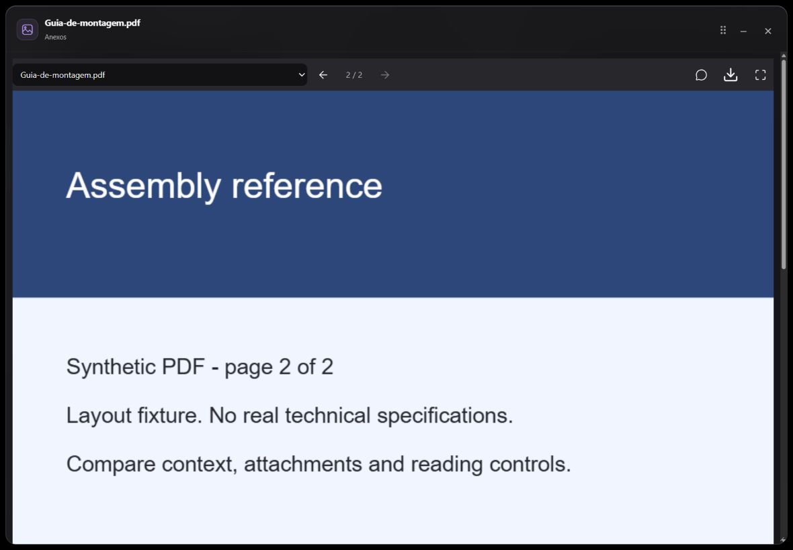

# Controles, notas e anexos — 11/10/2026

Revisão sobre a base `f60e6b89a3714bc1ed928690c57f857769b36cbb`, na branch `codex/canvas-attachments`. Os resultados abaixo correspondem à implementação desta rodada, não à paleta anterior. A publicação e seu commit devem ser conferidos pelo histórico e pelo estado da implantação.

## Resultado de interface

- Board e planner: barra recolhida com ferramenta atual, desfazer e saída; refazer aparece quando disponível. Escolhas abrem por clique ou teclado, em coluna lateral ou linha superior. Histórico fica fixo e somente as escolhas rolam. Não há favoritos. Cor, espessura e opacidade ficam num popover limitado pelo canvas.
- Planner: os controles do mapa cedem espaço durante o desenho em tela estreita. Maximizar preserva acesso à restauração sem sobrepor a barra. Ctrl/Cmd+Z funciona também com foco na barra recolhida.
- Notas: um convite inicial à escrita, menu compacto por nota/parágrafo, um microfone no cabeçalho e inclusão de parágrafo com foco imediato. Documentos existentes não são reescritos para essa mudança de apresentação.
- Planner: cabeçalho em uma faixa e cartão padrão em todos os níveis de zoom. Afastar o mapa não troca o cartão pela miniatura nem pela versão expandida.
- Anexos: clipe compartilhado, busca/filtro, importação de originais, seleção de vários arquivos para um deck, posicionamento e redimensionamento no canvas. Leitor sobre o canvas, páginas de PDF sob demanda e referência explícita ao chat, sem envio automático.

Contratos e limites: [tinta](../design/compact-ink-controls.md), [notas](../design/notebook-editor.md), [anexos](../design/canvas-attachments.md).

## Verificações executadas

| Comando | Resultado |
| --- | --- |
| `npm test` | 228 arquivos aprovados, 2 ignorados; 2.432 testes aprovados, 8 ignorados. |
| `npx vitest run src/ink src/attachments src/boards/BoardCanvas.test.tsx src/workspace/Notes.editor.test.tsx src/workspace/Notes.ink.test.tsx src/workspace/NoteCanvas.test.tsx src/components/ConceptNode.test.tsx src/workspace/Workspace.plannerHeader.test.tsx` | Rodada posterior aos ajustes finais de atalhos/PDF: 25 arquivos e 249 testes aprovados. Não somar esse número ao total da suíte. |
| `npm run test:gateway` | 226 aprovados e 1 ignorado. |
| `npm run build` | TypeScript e Vite aprovados. Aviso existente de chunks acima de 500 kB permanece. |
| `npm run lint` | TypeScript aprovado. |
| `npm run check:bundle` | Aprovado; nenhum módulo de funcionalidade carregado antecipadamente pelo conjunto auditado. |
| `npm run check:repo` | 34 documentos mantidos, 903 links locais e 7 fronteiras transitivas; aprovado. |

A suíte exercita cancelamento, troca de conta/canvas, referência de mídia em exportação/coleta, limites de arquivos e metadados, seleção de deck, worker PDF, cancelamento de render anterior, gestos, histórico e fechamento por teclado. Uma revisão independente final não encontrou bloqueadores na barra e suas integrações.

## Conferência em navegador

Vite do worktree em `127.0.0.1:5195`, separado do localhost principal. Fixture usa componentes reais de App, Workspace, GraphCanvas, Board e notas, com documentos sintéticos em memória e originais PDF/PNG locais; chamadas externas foram bloqueadas. Nenhum dado pessoal foi usado no ensaio.

| Superfície | Observação |
| --- | --- |
| Desktop 1440 × 1000 | Barra mínima, escolha de marca-texto, traço, desfazer, refazer e saída; cabeçalho único do plano; nova nota com um placeholder. |
| Tablet emulado 1180 × 820 | Faixa lateral compacta; deck com dois PDFs; página 2 no leitor maximizado; referência do PDF no chat. Arrasto compensou o zoom e resize por teclado funcionou. |
| Celular emulado 390 × 844 | Faixa horizontal; alvos de histórico/saída com 44 px; ajustes contidos na tela; controles do mapa sem sobreposição. |
| Celular emulado 320 × 740 | Barra e biblioteca dentro da largura; rolagem restrita às escolhas; restauração acessível no modo maximizado; nota sem overflow horizontal. |

## Limites

Esta rodada não mediu precisão ou conforto com S Pen física, nem refez o ensaio simultâneo tablet/PC. Também não validou upload autenticado no Supabase em produção. A biblioteca reaproveita o transporte de mídia/cofre existente; não altera banco, RLS ou configuração de autenticação.

Resultados de pesquisa confirmados ainda não são salvos automaticamente na biblioteca. Links têm ficha e abertura externa, sem navegador incorporado. PDFs antigos que só guardaram texto precisam de reimportação do original; não há OCR. Cartões de anexos ainda não participam de seleção múltipla, clipboard, histórico de tinta e enquadramento automático dos nós. Imagens inline antigas do Board não foram migradas automaticamente. Esses limites permanecem documentados para a próxima etapa.
