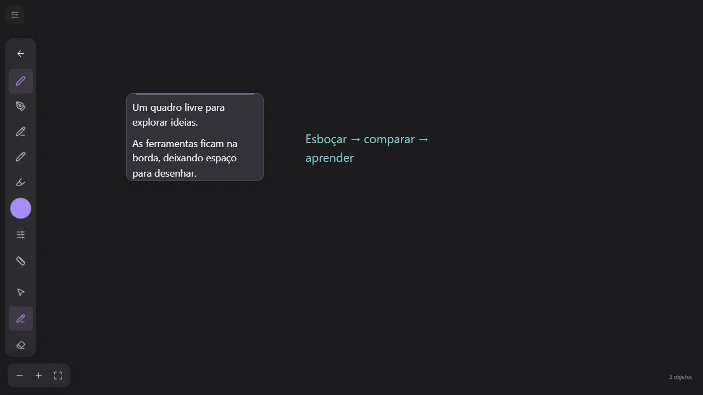
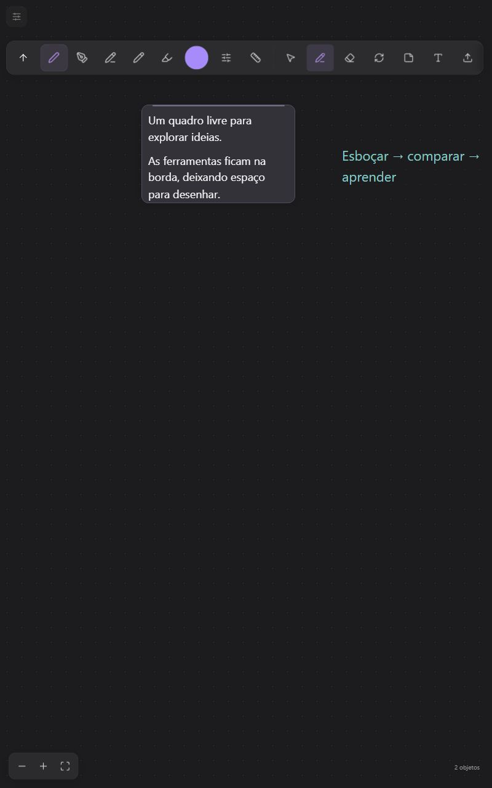

# Paleta compacta do Dynamic Board — 11/10/2026

> Registro histórico da implementação anterior. A reconstrução posterior, com histórico sempre acessível e escolhas abertas por clique, está descrita em [Controles compactos de tinta](../design/compact-ink-controls.md). As medidas e capturas abaixo não representam a barra atual.

## Alteração

O painel fixo de 300 px, que quebrava ferramentas em várias fileiras, foi substituído no Dynamic Board por uma faixa única. O canvas largo usa a lateral esquerda em coluna; o canvas alto usa o topo em linha. A orientação acompanha o tamanho real do canvas, inclusive na maximização, sem observar cada frame do desenho.

A faixa conserva botões de 44 px e rola no próprio eixo quando as ferramentas não cabem. Canetas, cor, ajuste de traço e régua aparecem primeiro. Recolher permanece acessível durante a rolagem; desenhar com dedo usa um ícone com nome acessível. A abertura mantém o primeiro controle no mesmo ponto para evitar selecionar outra ferramenta quando o painel aparece sob o ponteiro.

Os ajustes de espessura/opacidade abrem num popover de até 254 px, dentro dos limites do canvas. O popover é irmão da faixa rolável e continua dentro da fronteira de eventos da paleta: não é cortado pelo scroll nem inicia um desenho ao tocar seus controles. Escape retorna o foco ao botão de ajuste. As notas e o planner continuam usando a variante padrão da paleta.

Código: [InkPalette](../../src/ink/InkPalette.tsx), [contexto do overlay](../../src/ink/InkPaletteOverlay.ts), [InkToolbar](../../src/ink/InkToolbar.tsx), [BoardCanvas](../../src/boards/BoardCanvas.tsx).

## Verificação

Ensaio local em origem descartável, com quadro sintético e acesso externo bloqueado. Não houve alteração de projetos ou desenhos reais.

| Cenário | Observação |
| --- | --- |
| Antes, desktop | Painel de 300 × 361 px |
| 1280 × 720, maximizado | Coluna de aproximadamente 55 × 580 px; botões de 44 px; espaço de 12 px acima dos controles de zoom |
| 800 × 1280, maximizado | Linha de aproximadamente 776 × 55 px; preservação da ferramenta ao girar a tela |
| 390 × 844, normal e maximizado | Uma única linha, sem overflow horizontal da página; lápis separado do botão que revela o cabeçalho |
| 320 × 720, com estilos mobile do workspace | Faixa rolável de aproximadamente 271 × 65 px; régua na mesma linha, sem sobreposição nem overflow da página |
| Ajustes | Slider editável por teclado; Escape fecha o popover; dimensões não ampliam a faixa |
| Rolagem | Acesso ao modo de dedo no final da coluna; recolher permanece visível |

`npm test -- src/ink src/boards/BoardCanvas.test.tsx src/workspace/NoteCanvas.test.tsx`: 12 arquivos e 168 testes aprovados. As regressões exercitam paleta, popover, gestos, renderização de tinta, transporte ao vivo e integração de Board, notas e planner. TypeScript/build, orçamento do bundle e integridade documental são verificados antes da integração. Os testes específicos cobrem rotação da superfície, foco por toque, abertura por hover, interação com sliders, fechamento externo e posicionamento nos quatro lados.

A revisão independente identificou uma regra mobile antiga que retirava a régua da faixa em telas de até 360 px. A correção restabelece o fluxo do botão e a largura natural dos grupos somente na variante compacta; o caso foi conferido no navegador em 320 px com os estilos mobile do workspace carregados.

## Limites

A avaliação responsiva usa emulação de viewport no navegador; não é um novo ensaio com o S9 físico. Esta alteração não modifica o motor de tinta, o transporte de sincronização ou a geometria 3D e não comprova melhoria do desempenho geral da aplicação.
