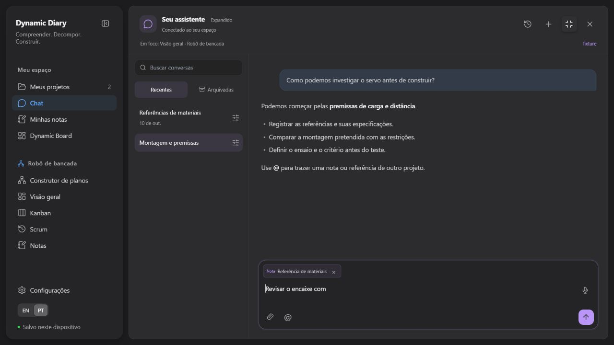
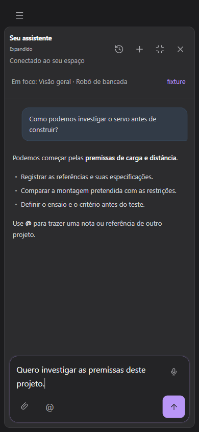

# Chat contextual — 11/10/2026

## Escopo

O assistente integrado passou a capturar a tela e o foco de cada envio, aceitar referências de outras origens, alternar entre popup e chat expandido e administrar conversas recentes/arquivadas. O histórico visível permanece completo; apenas o contexto enviado ao modelo é compactado.

Contrato e fontes: [módulo](../modules/chat-and-dairo.md), [estratégia de contexto e pesquisa do Codex](../design/chat-context-strategy.md), [especificação](../superpowers/specs/2026-10-11-contextual-chat.md) e [plano de implementação](../superpowers/plans/2026-10-11-contextual-chat.md).

## Diagnóstico e correções

| Problema observado no código | Comportamento implementado |
| --- | --- |
| O projeto ativo podia sobreviver à navegação para diário pessoal, lista de projetos ou boards | Fotografia imutável da tela, projeto visível, plano/nó, nota ou quadro realmente aberto; modo expandido conserva a tela de origem |
| Referências ficavam limitadas ao projeto aberto | `@` com identidade/origem e snapshots limitados; escolher outra fonte não troca o alvo de uma alteração |
| A leitura do plano carregava estruturas internas e conteúdo pesado | Projeção pública paginada de nós, conexões e sugestões; conteúdo detalhado e trechos longos são lidos sob demanda |
| O contexto usava um corte fixo de mensagens antigas | Checkpoint incremental aos 60% do orçamento, dois turnos recentes completos e pares de ferramentas preservados |
| Uma reserva fixa subestimava as instruções e schemas das ferramentas | Mesmo construtor de prompt e schemas enviados entram na estimativa; cada etapa do loop revalida o orçamento antes de pedir outra resposta |
| Troca de modelo ou sessão podia atravessar etapas assíncronas | Guards interrompem o turno antigo e recusam callbacks/mutações atrasadas |
| Uma ação aplicada podia perder sua auditoria se o salvamento terminasse após cancelar | Recibo terminal restrito à ação iniciada e à mensagem de origem, mesmo em conversa inativa; conversas excluídas não são recriadas |
| Conversas inativas e arquivadas compartilhavam o mesmo significado | Estado explícito de arquivo, título, datas, busca, restauração e exclusão com recibo sem conteúdo |
| Texto em streaming atualizava e serializava o estado a cada delta | Agrupamento em até 80 ms, auditoria imediata e flush ao concluir, falhar ou cancelar; paginação de 60 mensagens na interface |

O revisor independente examinou escopo, orçamento, migração, interrupção e interface. Os achados intermediários orientaram as correções; os resultados consolidados ficam abaixo.

## Verificação visual local

Foi usada uma origem descartável em `127.0.0.1:5195`, com dados sintéticos e chamadas externas bloqueadas. O modelo de resposta era simulado; não houve acesso à conta, senha, conversas ou projetos reais durante esse ensaio.

- O botão lateral abriu o mesmo chat em modo expandido, com a tela de origem visível no contexto.
- Selecionar uma nota de outro projeto com `@` conservou o projeto de origem.
- Texto e referência permaneceram ao recolher/expandir.
- A interface expôs recentes, arquivadas, busca e ações de histórico.
- Em 390 × 844, a largura de rolagem permaneceu em 390 px e o compositor coube na tela. Abrir o histórico ocultou o compositor, levou o foco à busca e preservou o rascunho ao fechar.
- A avaliação responsiva usou emulação de viewport, não um tablet físico.

## Resultados automatizados

| Verificação | Resultado |
| --- | --- |
| `npm test -- --maxWorkers=4` | 213 arquivos aprovados, 2 pulados; 2.264 testes aprovados, 8 pulados, nenhuma falha |
| `npm run test:gateway` | 226 testes aprovados, 1 pulado, nenhuma falha |
| `npm run build` | TypeScript e build de produção aprovados |
| `npm run check:bundle` | Orçamento aprovado; nenhum módulo pesado de recurso importado antecipadamente |
| `npm run check:repo` | 34 documentos mantidos, 858 links locais e 7 fronteiras de módulos verificados |
| `git diff --check` | Sem erros de whitespace |

Os 8 testes pulados na suíte principal são ensaios live dependentes de provedores externos. No gateway, o teste de symlinks é explicitamente pulado no Windows. A suíte principal usou poucos workers para limitar a concorrência na máquina. O build ainda informa chunks acima de 500 kB; esta entrega não comprova resolver o desempenho geral do produto.

A revisão independente fechou sem bloqueios depois das regressões de foco do histórico, mudança de modelo durante geração, IDs das propostas e auditoria tardia após cancelamento/recarga. Os testes de compactação usam o SDK real com modelos determinísticos.

## Limites

- Sem metadado verificado da janela do modelo, o orçamento da aplicação é de 32.768 tokens. O indicador mostra estimativa e seu tooltip explica esse fallback; ele não declara a janela real do provedor.
- A contagem textual conservadora por bytes UTF-8 não substitui o tokenizer exato nem mede faturamento. A observação do último input do provedor ajuda a estimar crescimento, sem somar todas as requisições.
- Resumos podem perder detalhes. A fonte completa continua no histórico visual e deve ser consultada para conferência; sucesso nos testes não comprova memória perfeita ou redução de custo/latência num percentual fixo.
- A bateria usa SDK real com modelos simulados. Não avalia qualidade semântica com chamadas pagas, cache do provedor ou todos os aparelhos físicos.
- Leitura e navegação de boards não oferecem edição arbitrária de seus objetos. Esta entrega não implementa o runtime do Dairo.
- Edições concorrentes da mesma conversa continuam sujeitas à conciliação conservadora. O exportador tabular legado não contém todos os metadados da persistência ativa.

## Integração

A entrega é integrada à `main`, que publica automaticamente o serviço `cellproject-builder`, ambiente `production`, projeto Railway `externo`. O fechamento da entrega identifica o commit e verifica o deploy correspondente, o endpoint `/healthz` e a correspondência dos arquivos publicados com o build local. Esses checks de publicação não acessam dados da conta do usuário. O localhost principal permanece em `http://127.0.0.1:5190/`.
