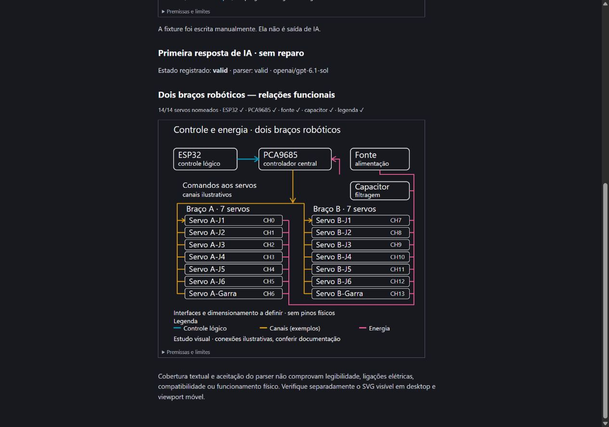

# Nomenclatura dos diagramas — 11/10/2026

O relato foi de uma ilustração mais elaborada, mas sem nomes no desenho. A inspeção mostrou que o contrato anterior aceitava documentos sem elementos `text`, além de texto vazio ou invisível. O renderizador preserva os textos fornecidos; não foi obtido o JSON do artefato fotografado para atribuir sua causa exata.

O guia compartilhado agora prioriza nomes de componentes, instâncias repetidas e relações, legendas e margens antes da decoração. O piso de geração rejeita resultados sem um rótulo alfanumérico com pintura e âncora admitidas, antes de inserir ou aplicar. Plano, Board, notas e revisão usam o mesmo piso. Os compositores preservam pedido e referências em caso de erro; não há reparo pago automático. Documentos antigos permanecem legíveis e exigem revisão explícita para receber novos nomes.

## Verificação automatizada

- `npm run test:all`: cliente com 2.059 testes aprovados e 8 ignorados; gateway com 226 aprovados e 1 ignorado. Total: **2.285 aprovados, 9 ignorados**.
- Guia final de geração: 4/4 testes; protocolo isolado do ensaio: 5/5 verificações offline.
- `npm run build`: aprovado; persistem avisos de chunks acima de 500 kB, anteriores a este recorte.
- Revisão independente do código de produção sem achados bloqueantes. Testes cobrem resultado sem textos, textos vazios/transparentes, bindings, rejeição antes de aplicar e preservação de pedido/contexto.

## Uma primeira resposta real

O [protocolo](../../scripts/diagram-labels/README.md) usa `buildDiagramSystem('plan')` real com contexto sintético e um pedido explícito de esquema funcional, sem dados do usuário. Foi executada **uma chamada**, sem reparo nem seleção de uma melhor saída. A configuração do ensaio não altera modelo nem orçamento da aplicação.

O resultado tem 76 elementos, **47 textos**, ESP32/PCA9685/Fonte/Capacitor/Legenda e 14 servos distintos em dois grupos de sete. Duração: 67.396 ms; 6.951 tokens totais. A [resposta original](data/diagram-labels-2026-10-11/response.txt), o [JSON decodificado](data/diagram-labels-2026-10-11/diagram.json) e o [manifesto](data/diagram-labels-2026-10-11/manifest.json) preservam a primeira tentativa e seus hashes. O SHA da revisão-base é acompanhado dos hashes das fontes alteradas ainda não commitadas no momento da chamada.

O SVG foi inspecionado com o `DiagramView` real em viewport desktop 1280 × 900 e móvel 390 × 844. Nomes e legenda estavam presentes e sem cortes observados. Os 47 textos ficaram dentro dos limites do SVG na verificação DOM móvel; não houve erro ou aviso no console. Os nomes dos servos ficam em torno de 10,6 CSS pixels quando o desenho inteiro cabe nessa largura de celular; anotações secundárias são menores e pedem zoom. Isso não demonstra leitura confortável em todo tamanho nem em aparelho físico.

[Captura do viewport móvel](data/diagram-labels-2026-10-11/mobile.jpg). A fixture manual exibida acima da resposta no viewer é identificada separadamente e não é tratada como resultado da IA.

## Limites

Uma chamada com pedido explícito de nomes não prova consistência em todos os pedidos ou modelos. O piso detecta ausência total de nomenclatura, mas não certifica cobertura de cada peça, caixas de glifos, sobreposição, contraste sobre todo path ou verdade das ligações. IDs e canais desta amostra são ilustrativos; não há validação elétrica ou física. A documentação atual do contrato está no [módulo de diagramas](../modules/diagrams.md).

## Revisão extra — 11/10/2026

Três revisores independentes examinaram contratos/serviços, interface e protocolo/evidências. Foi confirmado um defeito: uma revisão podia ser validada com defaults novos e depois aplicada com valores de controles antigos que recortavam seu único rótulo. A correção confere o estado efetivo preservado antes da gravação; se rejeitada, a revisão não modifica o documento, os valores ou o histórico.

As duas regressões (`x` na borda direita e baseline `y=0`) falharam antes da correção e passaram depois. A suíte relacionada passou com **161 testes em 12 arquivos**; a revisão independente da correção passou com 23 testes direcionados. A checagem do protocolo original passou com 5 testes, sem nova inferência paga. Interface e integridade/proveniência da primeira resposta não apresentaram outros achados acionáveis. Esta revisão não repetiu a bateria completa do gateway nem o ensaio em aparelho físico.
