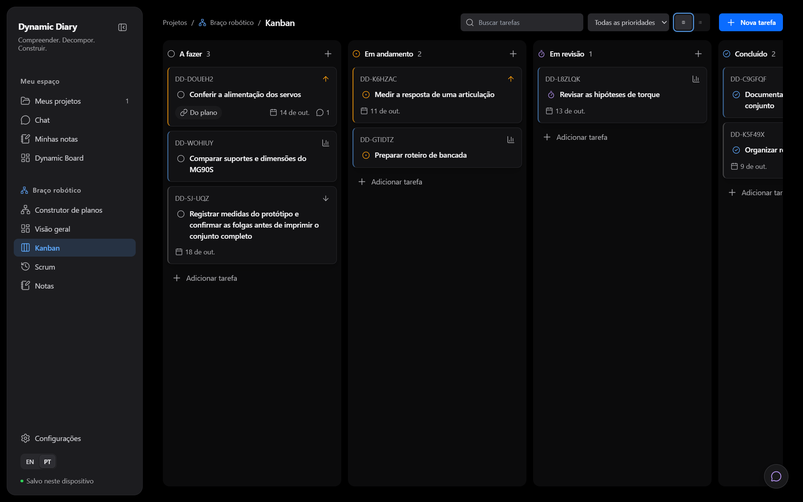
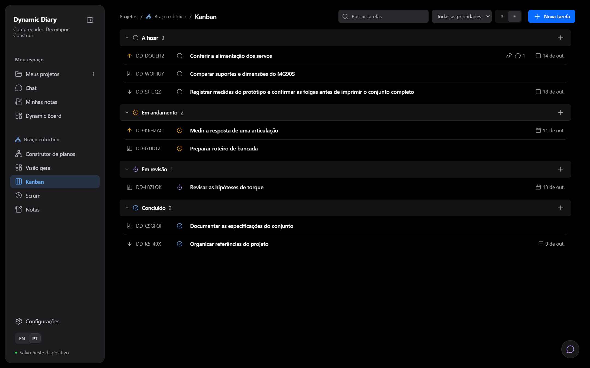
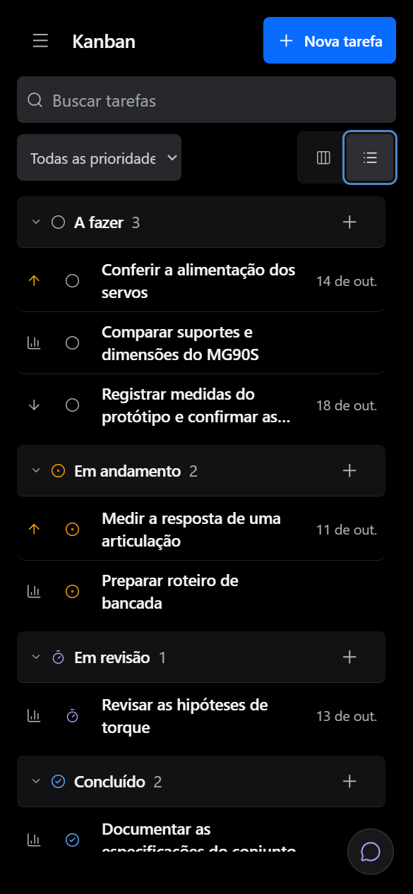
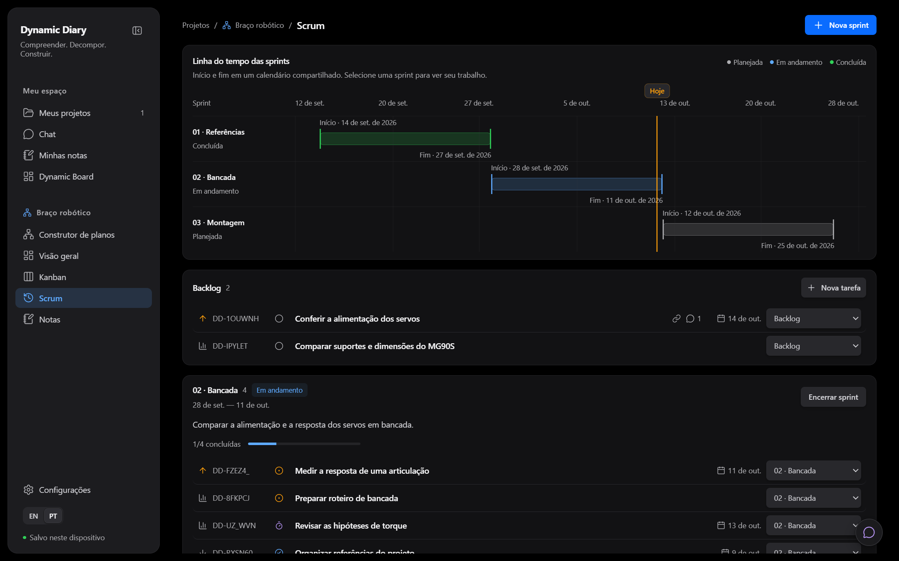
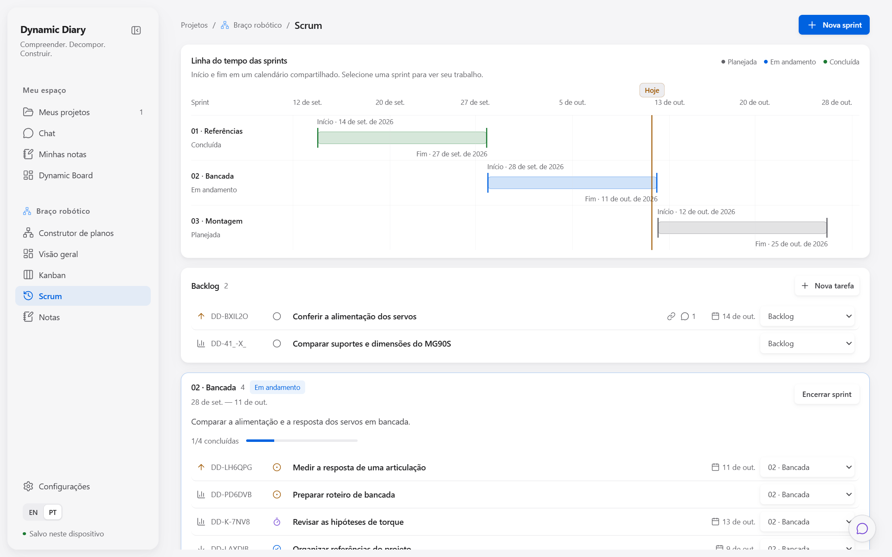
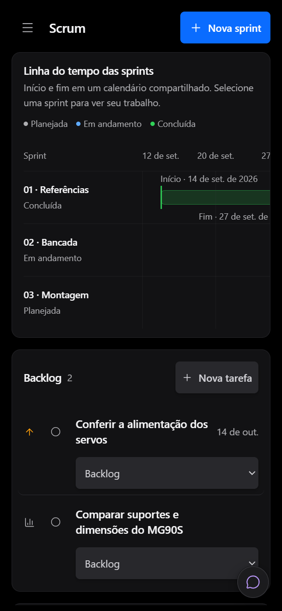

# Kanban, lista e Scrum: apresentação compartilhada

Data: 11 de outubro de 2026.

Código avaliado: branch `codex/execution-workspace-design`, sobre a revisão `fa60924a3bf5ffa38d26145436756d7090831d15`, incluindo os componentes e estilos descritos abaixo.

## Direção e fonte

As três visualizações adaptam o ritmo de coleções do repositório [Workspace Mega Vale](https://github.com/Mega-Vale-Transportes/workspace-megavale/tree/f3be27e9b4dc96153af46062ec8e22be9f4375e9), consultado no commit `f3be27e9b4dc96153af46062ec8e22be9f4375e9`. Foram lidos seu guia de design, Board, TaskList, SprintPanel e estilos de coleções, tokens e responsividade. A implementação conserva os temas, ícones e dados do Dynamic Diary. O contrato de manutenção está em [sistema de design](../design/system.md#issue-board-and-list).

O objetivo desta entrega é consistência visual. Ela não representa uma nova bateria de desempenho nem comprova redução de latência, consumo de memória ou tempo de renderização do canvas.

## Implementação

- Kanban: colunas de 320px, cabeçalhos de 48px e cards com referência, prioridade, estado e título. Origem no plano, prazo e comentários aparecem quando existem. O quadro possui rolagem horizontal e cada coluna possui rolagem vertical própria, com regiões nomeadas e acessíveis por teclado.
- Lista: trilhas fixas para prioridade, referência, estado, título, sinais de contexto e prazo. Os prazos permanecem alinhados mesmo quando uma tarefa não tem comentários ou origem no plano. Grupos continuam recolhíveis; filtros e preferência de visualização permanecem existentes.
- Scrum: reutiliza `TaskRow`, o mesmo componente da lista, acrescentando a atribuição à sprint. Backlog, sprints e histórico compartilham tipografia e espaçamento. O progresso deriva de tarefas concluídas / total da sprint; não há métricas sintéticas de saúde. O histórico conserva acesso ao editor e mostra estado sem um seletor mutável.
- Em telas estreitas, referência e sinais secundários cedem espaço ao título; a atribuição à sprint fica abaixo dele. Títulos podem ocupar duas linhas. A faixa de estado e seu controle crescem juntos para 44px em layouts de telefone ou ponteiro de toque.

Não foram adicionadas dependências nem alterados esquemas de persistência, políticas de acesso ou serviços de IA.

## Verificação

| Verificação | Resultado |
| --- | --- |
| Suíte completa `npm test -- --maxWorkers=3` | 216 arquivos aprovados; 2 ignorados. 2.344 testes aprovados; 8 ignorados, incluindo testes de provedores externos. |
| `npm run lint` | Aprovado. |
| `npm run build` | Aprovado; repetido após o ajuste final de corte dos títulos no celular. |
| `npm run check:bundle` | Aprovado; nenhum módulo de funcionalidade carregado antecipadamente indevidamente. |
| `npm run check:repo` | Aprovado. |
| Revisão independente dos componentes e CSS | Sem bloqueios restantes; corrigida uma sobreposição entre controle de estado e título em largura intermediária. |
| Atribuição de sprint no navegador | Mover uma tarefa do backlog atualizou sua contagem e a contagem da sprint. Concluir a tarefa atualizou o progresso para 2/5. |
| Navegação da timeline por teclado | Selecionar sprint concluída abriu o histórico correspondente e focou seu resumo. |

A conferência de navegador utilizou o Workspace real e seus stores com dados sintéticos em uma origem local isolada, sem chamadas de IA ou gravações na conta do usuário. Kanban, lista e Scrum foram inspecionados em larguras de 320, 390, 760, 1.024 e 1.440px. Nas larguras menores, a largura do documento permaneceu igual à viewport; a rolagem horizontal ficou contida no quadro/timeline. Os temas OLED, escuro e claro foram conferidos. No modo lista, um título longo foi usado para confirmar o limite de duas linhas sem uma terceira linha visível.

O aviso existente de chunks superiores a 500kB permanece no build. Esta entrega não contém um ensaio em tablet físico nem de arraste por toque; as capturas mobile são emulação de viewport no navegador.

## Capturas da implementação

Os dados abaixo são sintéticos e servem para conferência visual.

### Kanban

### Lista

### Scrum

