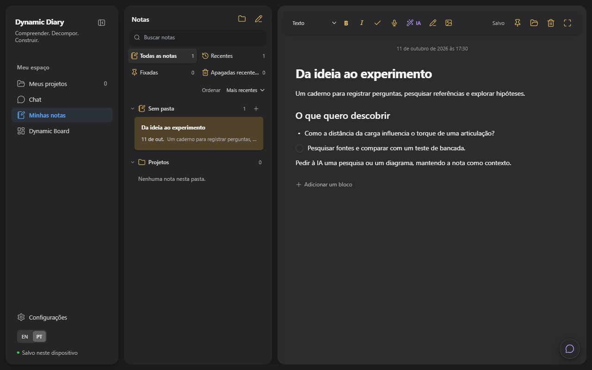
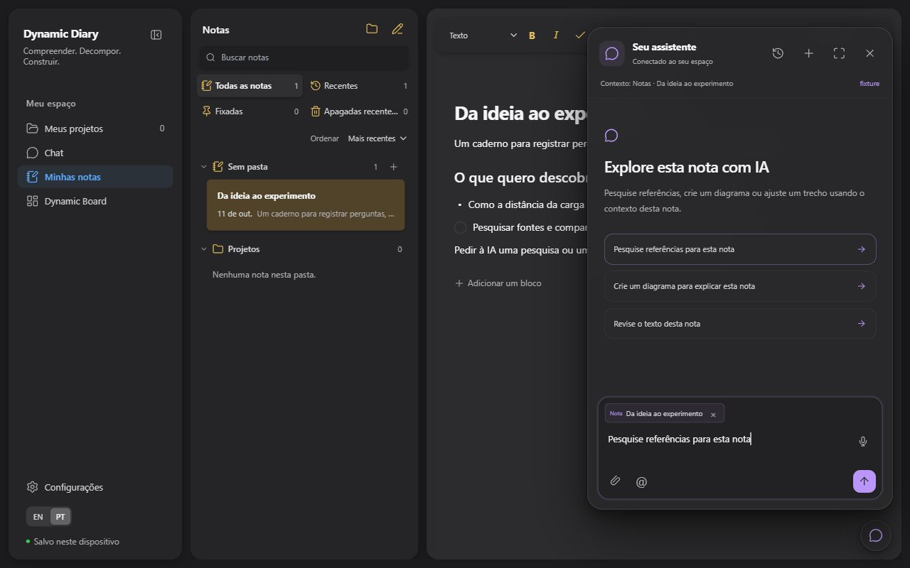
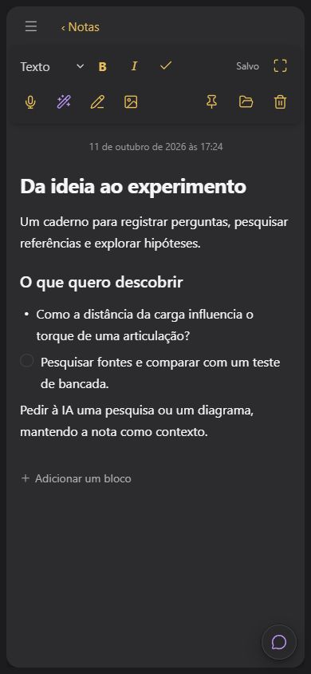

# Notas: ditado único e IA contextual — 11/10/2026

## Alteração

O editor usa textareas nativas com altura automática. Um único microfone na barra dita no título ou parágrafo utilizado por último, respeitando a seleção. A gravação reutiliza o serviço de áudio existente; não existe um gravador por linha. Trocar de nota, remover o campo ou ativar desenho invalida a operação. Uma edição concorrente não é substituída pela transcrição.

A entrada de IA abre o chat compartilhado com a nota visível como referência. Os exemplos de pesquisa, diagrama e revisão preenchem um pedido editável; não enviam sozinhos. A ação de um trecho usa o mesmo compositor. O chat também pode abrir sobre uma nota maximizada e fechar sem sair dessa visualização.

`note_research` usa o serviço de pesquisa existente com contexto textual limitado da nota, retorna fontes e não altera conteúdo. Salvar resultados exige pedido explícito. `note_diagram` reutiliza o gerador declarativo React/SVG, valida a resposta e acrescenta um item ao caderno atual, preservando outros objetos e desenhos. Ambos funcionam em notas pessoais ou de projetos sem exigir plano e mantêm a tela atual.

A revisão independente levou a quatro proteções adicionais: resolver referências explícitas além das 100 sugestões, preservar a identidade do trecho, limitar a metadata enviada ao modelo e comparar a baseline textual capturada no envio antes de uma revisão. A comparação é privada. Uma edição humana durante compactação, geração ou salvamento impede sobrescrita posterior; desenhos concorrentes continuam preservados. Acréscimos não apagam texto nem removem esse conflito.

Código principal: [Notes](../../src/workspace/Notes.tsx), [AudioField](../../src/audio/AudioField.tsx), [handoff](../../src/references/chatHandoff.ts), [AssistantChat](../../src/chat/AssistantChat.tsx), [noteTools](../../src/ai/noteTools.ts). Contratos completos no [módulo de notas](../modules/notes.md).

## Verificação visual

Ensaio em origem local separada, com nota sintética, componentes reais do workspace e chamadas externas bloqueadas. Não modifica notas da conta.

| Cenário | Observação |
| --- | --- |
| Desktop, 1280 × 800 | Um microfone na barra; nenhum no corpo; entrada de IA com nome acessível e referência visível no chat. |
| Tablet, 768 × 1024 | Controles continuam acessíveis com quebra de linha; sem overflow horizontal da página. |
| Celular, 390 × 844 | Barra em duas linhas, sem sobreposição dos controles nem overflow horizontal. |
| Celular estreito, 320 × 720 | Controles podem ocupar três linhas; continuam separados e dentro da largura disponível. |
| Nota maximizada | Revelar os controles e pedir IA abre o chat; fechar o chat conserva o editor maximizado. |
| Exemplo de pesquisa | O botão preenche o compositor e mantém a referência à nota; não inicia uma chamada automaticamente. |

## Verificação de software

`npm test -- --maxWorkers=3 --reporter=dot` executou 218 arquivos em 258,72 s: 215 aprovados, dois arquivos live pulados e um arquivo precisando de reexecução. Foram 2.341 testes aprovados, oito live pulados e uma falha no teste de acréscimo seguido de revisão. A execução começou antes do último ajuste desse guard; o caso revelou a necessidade de manter o conflito textual mesmo depois de um acréscimo permitido.

Após o ajuste, a rodada final de `workspaceTools`, `assistant`, `chat/store`, `workspaceAgent` e `noteTools` passou **112 testes em cinco arquivos**, incluindo esse caso, escrita sequencial legítima, edição durante compactação/salvamento e transporte privado da baseline pelo SDK. As contagens se sobrepõem e não devem ser somadas. O build TypeScript/Vite passou após corrigir a tipagem da fixture do adapter. Não há falha funcional conhecida restante nesses conjuntos.

A revisão estática independente confirmou resolução dos achados de referências, seleções, orçamento e escrita concorrente. A integridade do repositório conferiu 868 links locais e sete fronteiras de módulos, sem violações. `npm run check:bundle` passou, sem módulos de funcionalidades carregados antecipadamente fora do orçamento. Os avisos de tamanho de chunks do Vite continuam visíveis; este trabalho não pretende resolver a otimização geral do bundle.

## Limites

Os testes de áudio e serviços de IA usam implementações simuladas. A inspeção responsiva emula o viewport; não equivale a novo teste com caneta, microfone ou S9 físico. Esta entrega não faz uma nova chamada real ao provedor de pesquisa/diagrama. Busca de fotos e geração 3D continuam nas ferramentas de projeto. Não representa uma medição de melhoria do desempenho geral da aplicação.
