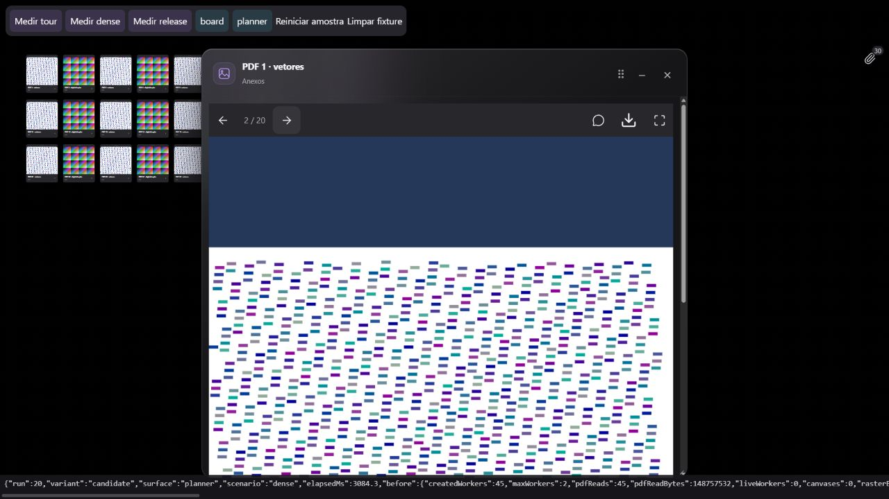

# PDFs nos canvases — desempenho e retenção

A bateria encontrou retenção real: depois de visitar 30 cartões e afastá-los da tela, a versão anterior mantinha 30 workers PDF e 9.792.000 bytes nominais de raster. As correções limitam o processamento de capas a duas por vez e liberam documento/worker após cada capa; fora da área visível, liberam também o bitmap. O resultado se repetiu no Dynamic Board e no Construtor de Planos.

## Protocolo e evidência

Baseline: `2d2e20fccc93d23845bd12cc327a13008a75619f`. Fontes congeladas, compiladas em modo produção com o mesmo lockfile; [manifesto de fontes e assets](../design/pdf-performance/build-manifest.json). A [fixture reproduzível](../../scripts/pdf-performance/README.md) monta o componente compartilhado real `CanvasAttachmentSurface`, React Flow, armazenamento local e PDF.js com workers reais em origem local dedicada, sem conta, dados pessoais, IA ou chamadas externas. Não monta o App inteiro.

Dois originais determinísticos de 20 páginas: PDF vetorial de 2.064.545 bytes e PDF com imagem de 4.724.212 bytes. Os cartões alternam referências a esses dois arquivos; não são 30/100 downloads distintos. Ambiente: Chrome 155 no Windows, 1280×720, DPR 1,5. Três repetições por variante/superfície, na ordem baseline Board, baseline plano, candidato Board, candidato plano. Cada repetição reinicia fora da tela, percorre quatro posições, mostra todos os cartões e afasta todos novamente.

As 36 amostras aceitas estão em [browser-results.json](../design/pdf-performance/browser-results.json). Todos os inícios de percurso tinham zero workers, canvases, trabalho pendente e erros; todos os cenários terminaram sem erro. O cenário denso concluiu os 30 canvases esperados. A reprodução inicial permanece [separada](../design/pdf-performance/browser-initial-reproduction.json). Uma tentativa concorrente com Vitest foi [preservada e excluída](../design/pdf-performance/browser-excluded-concurrent-suite.json) da comparação. O candidato congelado antecede a mudança do cache cloud: esse cache tem regressões automatizadas próprias, sem ganho de rede medido aqui.

## Comparação com 30 cartões

Os inventários abaixo foram idênticos nas três repetições de cada superfície.

| Indicador | Anterior | Corrigido |
| --- | ---: | ---: |
| Pico de workers durante capas | 30 | 2 |
| Workers retidos depois de todas as capas prontas | 30 | 0 |
| Workers retidos fora da tela | 30 | 0 |
| Raster nominal retido fora da tela | 9.792.000 bytes | 0 |
| Raster nominal com todos os cartões visíveis | 9.792.000 bytes | 9.763.200 bytes |

O bitmap visível continua necessário; a pequena diferença visível vem do arredondamento estrito das dimensões, não de compressão. `rasterBytes` é `width × height × 4` dos canvases DOM. `liveWorkers` conta objetos Worker até `terminate()`. Esses números não medem heap, memória total do processo ou GPU.

| Tempo de estabilização, mediana local | Anterior | Corrigido |
| --- | ---: | ---: |
| Percurso — Board | 2.251,2 ms | 2.439,5 ms |
| Mostrar todas as capas — Board | 724,1 ms | 1.631,6 ms |
| Percurso — plano | 2.256,0 ms | 2.661,2 ms |
| Mostrar todas as capas — plano | 728,5 ms | 2.142,0 ms |

Há um custo explícito: a fila limita concorrência e a liberação fora da tela exige nova renderização ao voltar. No percurso seguido do cenário denso, o candidato criou 45 workers ao longo do tempo, contra 30 na baseline, mantendo no máximo dois simultâneos. Tempos incluem esperas de estabilização; frames/Long Tasks são diagnósticos sensíveis ao agendamento. A rodada demonstra menor retenção e concorrência, sem provar aumento geral de FPS ou abertura mais rápida.

## Comportamento aplicado

- Capas começam perto da área visível do canvas, com margem de 160 px. Um intervalo de 750 ms preserva o bitmap durante um pan curto; depois ele é descartado.
- Fila compartilhada e cancelável com dois slots. O slot só é liberado após destruir o worker; cartões que saem antes de começar não leem o original.
- O leitor mantém somente a página atual, coalesce mudanças rápidas e libera recursos da página após render/cancelamento. PDFs inválidos destroem a tarefa imediatamente. Cada raster tem no máximo 4.000.000 pixels, com teto de 4096 por dimensão.
- Cache cloud de bytes com LRU e orçamento de 32 MiB por runtime. Leituras simultâneas do mesmo ID compartilham download/verificação; retornos independentes impedem mutação do cache pelo consumidor. Troca de catálogo, escrita e encerramento invalidam trabalho antigo.
- Na importação, preflight de catálogo/contexto, assinatura `%PDF-`, extração e limite de páginas acontecem antes de armazenar o original. Cancelamento e orçamento são reavaliados depois da extração.

## Validação complementar

O ensaio de 100 cartões e o teste de abrir/paginar/minimizar/restaurar/fechar estão registrados separadamente em [carga de 100 cartões](../design/pdf-performance/browser-100-cards.json) e [ciclo do leitor](../design/pdf-performance/browser-reader.json). Os 100 canvases concluíram sem erro, com pico de dois workers: 8.626,5 ms no Board e 7.869,0 ms no plano, incluindo estabilização. Visíveis, retiveram 32.544.000 bytes nominais de raster; fora da tela, zero. É uma execução de capacidade por superfície, não uma distribuição de latência. O leitor restaurou a página 2/20; minimizado e fechado não reteve worker ou raster; aberto reteve um worker e uma página. Não houve aviso de fake worker ou erro no console do candidato.

`npm test -- --reporter=dot`: **232 arquivos aprovados, 2 ignorados; 2.533 testes aprovados, 8 ignorados**. As regressões incluem 100 pedidos concorrentes de capa limitados a dois, cancelamento de fila, coalescimento de páginas, dimensões extremas, PDF inválido, troca de conta, preflight de importação, LRU, deduplicação e conclusão obsoleta após mudar catálogo. Revisões independentes de leitor/fila, domínio/capas e runtime não encontraram P1/P2.

`npm run build`, `npm run check:bundle`, `npm run check:repo` e `node scripts/pdf-performance/check-results.mjs` aprovados. O bundle não carregou módulos pesados de funcionalidade antecipadamente; PDF.js/leitor permanecem em chunks sob demanda. Permanecem os avisos conhecidos de chunks maiores que 500 kB e base Browserslist antiga. Essa rodada não resolve todo o desempenho da aplicação.

## Limites e próximas medições

O orçamento do cache não inclui buffers transitórios, bitmaps nem memória interna de PDF.js. Afastar o zoom pode mostrar 100 capas e manter seus rasters enquanto visíveis. Não foram medidos tablet físico, processo móvel, latência do armazenamento cifrado nem 100 originais distintos. Arquivos cifrados continuam baixados integralmente: HTTP Range exige outro contrato de cifra/autenticidade; não foi ativado nesta rodada.

Cancelamento depois de começar o upload ainda pode deixar mídia órfã para coleta posterior. O GC local ainda percorre entradas com bytes; separar índice de metadados é uma melhoria futura. PDFs com imagem não ganham OCR. Capas persistidas/deduplicadas por conteúdo seriam outro experimento para reduzir reprocessamento ao voltar a uma região, com orçamento e invalidação próprios.

As escolhas seguem os contratos de [cleanup de páginas/documentos do PDF.js](https://mozilla.github.io/pdf.js/api/draft/module-pdfjsLib-PDFDocumentProxy.html#cleanup) e a orientação do projeto sobre [custo de renderizar muitas páginas](https://github.com/mozilla/pdf.js/wiki/Frequently-Asked-Questions#i-want-to-render-all-100-pages-in-a-document-at-a-high-resolution-is-it-a-good-idea). Não são uma declaração de equivalência com a arquitetura interna do Notion.
