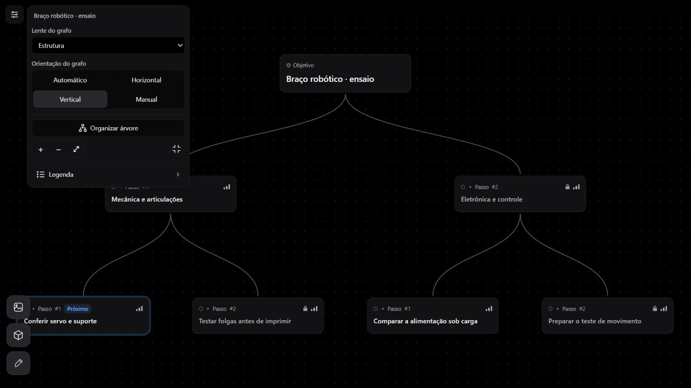
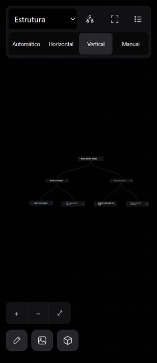
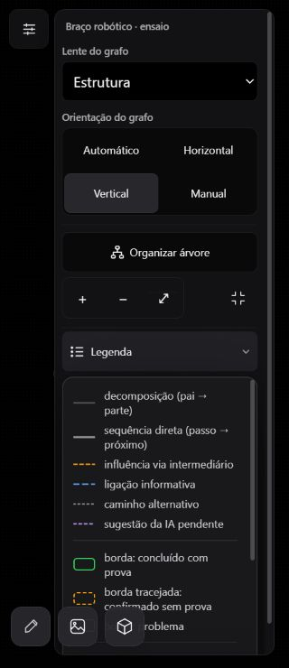
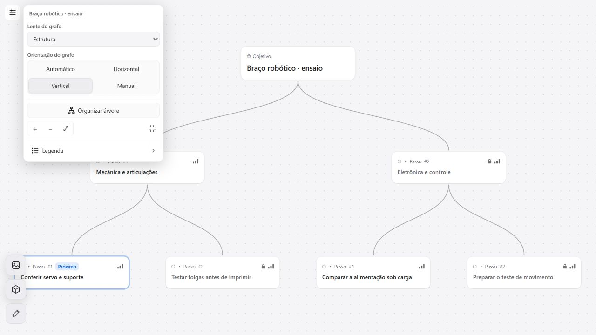

# Controles e organização do canvas — 11/10/2026

Revisão do painel do Construtor de Planos, especialmente no modo maximizado. Base: `0a83dfdfb25fb701d02cd25c9cbff1262a34becf`. O ensaio usa componentes reais, estilos na ordem da aplicação e sete nós sintéticos em origem local separada, sem chamadas a provedores de IA ou alteração de dados da conta.

## Defeitos confirmados

- Organizar árvore recalculava pela proporção da tela e forçava Automático. Assim, Vertical em uma tela larga voltava a Horizontal.
- Organizar incluía imagens/modelos distantes no enquadramento, embora apenas os nós fossem reorganizados.
- Organizar vindo de uma lente analítica podia receber o enquadramento comum da troca de lente, cortando uma árvore grande.
- Escolher Manual imediatamente após Organizar não cancelava o pedido pendente de câmera.
- No desktop maximizado, o cabeçalho principal desaparecia e os controles do canvas não ofereciam seleção de lente.
- O painel não distinguia abertura temporária por hover de abertura fixada por clique. Os testes reproduziram fechamento após pointerleave/blur e ausência de fechamento no segundo clique.

Vertical isoladamente funcionou no navegador de teste. Não foi reproduzida uma falha física do seletor nativo em Android; a revisão substitui o seletor de orientação por botões explícitos e cobre o comportamento de foco do painel sem atribuir a esse aparelho uma causa não verificada.

## Implementação

`PlannerCanvasControls` reúne lentes, orientação, organizar, zoom, expandir/restaurar e a legenda existente. No desktop normal, a seleção de lente permanece no TopBar. No maximizado, a paleta de aproximadamente 300px oferece todas as lentes e orientação em 2×2. No celular normal, mantém duas linhas, orientação em quatro colunas e zoom inferior separado. Cores usam tokens dos temas; toque usa alvos de 44px.

`ExpandedChrome` distingue hover/foco temporário de abertura fixada por clique. Clique fora, segundo clique e Escape fecham, com retorno de foco sem reabrir. A legenda consome o primeiro Escape; o painel, o seguinte; com ele fechado, Escape restaura o canvas.

`GraphCanvas` conserva a orientação escolhida ao organizar e agenda um enquadramento completo dos nós depois da adoção e medição da árvore. Imagens/modelos mantêm coordenadas; a ação explícita de ver o grafo inteiro ainda os inclui. Retornar a Manual cancela apenas o pedido pendente de organização, preservando pedidos explícitos de foco.

## Verificação

- Regressões executadas em RED antes dos fixes e depois em GREEN: orientação, Manual, artefato distante, árvore grande e medição atrasada, corrida Organizar→Manual, painel fixado/foco e lentes disponíveis.
- 77 testes focados aprovados: `GraphCanvas.autoLayout`, `PlannerCanvasControls`, `ExpandedChrome` e `autoLayout`.
- Suíte do cliente: 2.373 testes aprovados, oito ignorados; 218 arquivos aprovados e dois ignorados.
- Build de produção, TypeScript, orçamento de bundle, links/documentação e `git diff --check` aprovados. Os avisos existentes de Browserslist desatualizado e chunks acima de 500kB permanecem; esta revisão não altera o motor 3D nem a estratégia geral de carregamento.
- Chromium integrado: larguras 320, 390, 1024 e 1280; painel dentro do viewport, botões móveis de 44px, seleção Vertical/Horizontal seguida de Organizar, cinco lentes e sequência de Escape.
- Temas OLED e claro inspecionados. Nenhum teste físico no tablet ou geração de IA faz parte deste ensaio.
- O carregamento limpo final, seguido de Vertical→Organizar, não produziu erros de console. As remontagens da página de ensaio durante HMR geraram avisos transitórios de `createRoot` duplicado; não apareceram após recarregar a página limpa.

## Evidências locais

