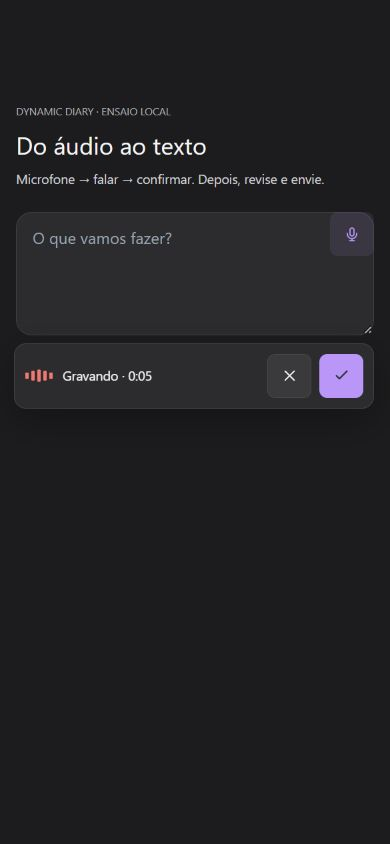
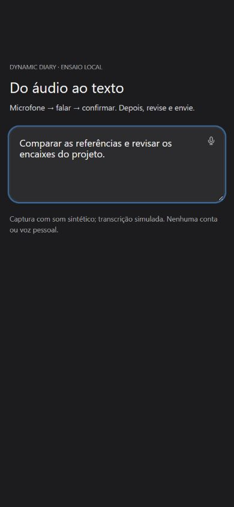

# Ditado direto e recuperação de capacidade — 11/10/2026

## Objetivo e escopo

Simplificar o áudio para microfone → falar → confirmar → texto no campo original. A captura foi adaptada do repositório autorizado `Mega-Vale-Transportes/workspace-megavale`, revisão `f3be27e9b4dc96153af46062ec8e22be9f4375e9`, conservando o transporte e o modelo STT do Dynamic Diary. A [documentação do módulo](../modules/audio-input.md) registra os arquivos de referência e as diferenças da adaptação.

O botão inicia a captura diretamente. Cancelar descarta; confirmar transcreve e devolve o foco ao texto editável. Não envia a mensagem nem gera o artefato automaticamente. Falas longas são divididas em arquivos completos; nova tentativa reaproveita os trechos já transcritos. Não há seleção de modelo, idioma ou resultado em uma tela separada.

## Evidência local

O ensaio de navegador utilizou o componente real `AudioTextarea`, `getUserMedia` substituído por um MediaStream de som sintético, `MediaRecorder` real e resposta HTTP de transcrição simulada. Captura, confirmação, validação de contêiner e inserção no campo foram exercitadas sem voz pessoal, conta real ou chamada paga.

No viewport 390 × 844, os controles permaneceram dentro da tela, com ações de toque de 44 px. Confirmar encerrou a captura e colocou a transcrição no campo original, mantendo a possibilidade de editar. A viewport temporária foi restaurada e a aba de ensaio foi fechada; o localhost principal foi preservado.

| Gravando | Texto inserido |
|---|---|
|  |  |

## Verificação automatizada

- Suíte geral: **2.134 testes aprovados**, 206 arquivos; oito testes de inferência ao vivo desabilitados por padrão. Essa execução cobre o aplicativo inteiro, não representa 2.134 testes específicos de áudio.
- Após os últimos ajustes da revisão: **267 testes aprovados** nos 11 arquivos de áudio, escopo/diálogo, classificação de erros, serviço de IA e estúdio visual. Essa rodada reexecutou os módulos afetados; sua contagem se sobrepõe à suíte geral.
- Revisão posterior da captura: **32 testes aprovados**, incluindo fala de 400 ms, falha/suspensão do medidor, cancelamento, ordem dos arquivos, cinco minutos, 12 MiB e recuperação de arquivos já completos.
- Contratos HTTP de áudio e servidor de produção: **34 testes aprovados** em `server/cloudAI.audio.test.mjs` e `server/production.test.mjs`.
- Interface: regressões de troca de escopo, resposta tardia, foco, Escape, composição IME, referências `@`, limite do campo, clipboard indisponível e recuperação após interrupção.
- `npm run build`, `npm run check:repo` e `npm run check:bundle` aprovados. A auditoria de bundle não encontrou os módulos pesados proibidos no carregamento inicial. Isso não é uma nova medição de fluidez ou FPS; os chunks grandes já existentes continuam fora do escopo desta mudança.

A revisão encontrou e corrigiu perda de cauda curta e descarte de trechos completos em interrupções. Também cobriu a falha opcional do medidor após silêncio: a falta de medição não pode ser usada como evidência para descartar fala posterior. Cancelamento e excesso de tamanho nunca oferecem arquivos parciais para envio.

## Recusa de geração de diagramas

A mensagem de demanda máxima enviada pelo usuário é reproduzida nos testes, junto de `NoCapacity`, wrappers do SDK e 429/503. O compositor mostra uma orientação localizada, conserva pedido e referências e permite nova tentativa explícita pelo mesmo botão. `Retry-After` é apresentado quando disponível. Falhas de autenticação, créditos e configuração não devem ser mascaradas como demanda temporária. Nenhum modelo, orçamento de saída ou contrato de diagrama foi alterado.

## Limites

Não houve nova inferência paga nem ensaio de microfone físico nesta bateria. O teste sintético não mede reconhecimento com voz humana, ruído, sotaques, qualidade no S9 ou latência do provedor. O tratamento de capacidade não elimina indisponibilidade externa e não demonstra que o contexto causou a recusa da captura. O comparativo histórico dos modelos STT permanece separado na documentação do módulo.
