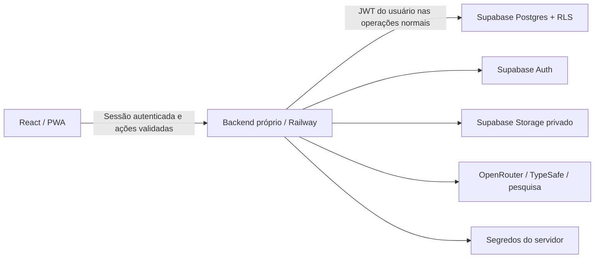

# Migração da persistência para Supabase — inventário e desenho

Data: 10/10/2026. Estado: **proposta técnica, sem implementação ou alteração remota**. Inventário feito por leitura do código; nenhum conteúdo do IndexedDB, `.env`, token ou arquivo privado do usuário foi lido. Não houve conexão, migration SQL, criação de conta/projeto nem deploy.

## Decisões do usuário

- Concluir revisão e integração das frentes atuais antes de implementar esta migração.
- Supabase na organização **P&D** como persistência de toda a aplicação.
- Manter o backend próprio; hospedar no projeto externo do Railway indicado pelo usuário.
- Permitir acesso somente a **wylgnerbossman@gmail.com**.
- Preservar os dados e credenciais locais durante a transição; nenhuma limpeza local é parte deste desenho.

O coordenador confirmou posteriormente o destino P&D: project ref `wxfootrnfiqpzhmjwgck`, organização `hhimdmantemhxnikmklr`. Este inventário não consultou o conteúdo remoto. As alterações continuam adiadas até a revisão e integração, conforme a ordem do usuário; nenhum recurso de outro contexto organizacional será usado como substituto.

## 1. Persistência existente

Os seis stores JSON usam Zustand persist com envelopes `{ state, version }`. `idb-keyval` usa por padrão o banco `keyval-store`, object store `keyval` (confirmado na versão instalada); a biblioteca de mídia tem banco próprio.

| Fonte | Chave / versão | Conteúdo persistido | Destino proposto |
| --- | --- | --- | --- |
| `src/workspace/store.ts` | `cellproject-workspace`, v2 | Projetos, tarefas, comentários, sprints, notas, pastas, `legacyImported`; projetos contêm planner e anexos | Entidades de domínio e snapshot versionado do planner |
| `src/store.ts` | `cellproject-graph`, v6 | Projeto ativo, arquivo, rascunhos, objetivo, propostas pendentes/estacionadas/arquivadas; seleção, foco, lente e modo | Planner canônico por projeto; preferências de visualização separadas |
| `src/chat/store.ts` | `dynamic_diary-chat`, v1 | Sessão atual e arquivadas, mensagens, histórico do modelo, `pendingHistory`, cooldowns por provedor/modelo | Conversas, mensagens, contexto e recuperação de operações interrompidas |
| `src/kb/store.ts` | `cellproject-kb`, v2 | Documentos extraídos e resumos, `pickCache`, uso de documentos | Documentos KB e uso; cache versionado/reconstruível |
| `src/config/store.ts` | `cellproject-config`, v4 | Provedor ativo, modelos, pesquisa web e configuração por provedor, **incluindo API keys** | Preferências não secretas no banco; segredos somente no servidor |
| `src/i18n/store.ts` | `cellproject-locale`, v1 | Idioma | Preferência da conta |
| `src/visuals/media.ts` | Banco `cellproject-visual-media`, store `media` | `id`, MIME, nome, `ArrayBuffer`, data e projeto | Bucket privado e catálogo relacional de mídia |
| `src/theme.ts` | localStorage `dynamic_diary-theme` | Tema | Preferência da conta |
| `src/workspace/sidebarPreference.ts` | localStorage `dynamic_diary-sidebar-collapsed` | Sidebar recolhida | Preferência da conta ou do dispositivo |
| `src/workspace/Board.tsx` | localStorage `dynamic_diary:task-view` | Lista/quadro | Preferência da conta ou do dispositivo |
| PWA | CacheStorage `dynamic-diary-shell-*` | Somente shell/ícones/assets públicos enumerados do build | Cache técnico; não é banco de dados do usuário |

### Cópias e objetos que exigem cuidado

`src/workspace/planner.ts` mantém um editor singleton e captura o planner no projeto proprietário. O mesmo plano pode existir em `cellproject-graph` e no snapshot do workspace. Antes do backup/importação, é necessário identificar o proprietário atual, capturar o editor mais recente, aguardar as gravações e reconciliar os dois envelopes. Não usar simplesmente a última data de modificação de uma chave.

Arquivos de plano/chat (`src/attachments/files.ts`) guardam **texto extraído**, nome, tamanho, fingerprint e indicação de truncamento. PDF/DOCX/código original não é arquivado por esse caminho. A KB também não armazena o PDF binário (`src/kb/types.ts`). A migração consegue preservar exatamente o que existe; não pode reconstruir os originais ausentes. Uma futura retenção de originais precisa mudar a entrada de novos arquivos e permitir reanexar os antigos.

Mídia visual guarda bytes reais, com limites locais atuais de 10 MiB por arquivo, 5 MiB por imagem, 50 MiB por projeto e 500 MiB globais. Esses limites não representam a quota do futuro projeto Supabase. `collectVisualMediaIds` e os snapshots arquivados, propostas e origens retidas devem entrar na enumeração de referências. Não importar apenas os objetos atualmente visíveis no canvas.

As URLs `/api/visuals/media?sessionId=…&candidateId=…` vêm de um registro em memória com expiração de 30 minutos (`server/referenceRegistry.mjs`). São acesso temporário a uma pesquisa, não identidade durável de arquivo. Imagens aceitas devem apontar para mídia própria persistida, mantendo URL da página, autoria/licença quando informadas, dimensões, avaliação e origem da busca. Uma referência expirada sem bytes locais deve aparecer no relatório como ausente, sem substituição silenciosa por outra imagem.

### Estado que hoje é transitório

Órbita/zoom/peça selecionada (`visuals/rendering/viewStore.ts`), abertura/minimização de ferramentas (`visuals/ui/uiStore.ts`), posição/tamanho de popups, controladores de requisição, seleção de superfície e boa parte da navegação não são hoje persistidos. Não há dados antigos desse tipo para migrar. Decidir separadamente quais se tornam preferências; nunca serializar AbortController, renderer, object URL, sessão de busca expirada ou objeto Three.js vivo.

O backend atual também mantém sessões locais e rate limits em memória. O cookie de acesso local protege o gateway de desenvolvimento; não representa login de produção. Credenciais e limites do provedor devem continuar separados da persistência do plano.

## 2. Base existente e lacunas confirmadas

Há uma abstração local em `src/data/workspaceRepository.ts`, exportadores puros em `src/data/workspaceTransfer.ts` e um **rascunho não aplicado** em `docs/database/workspace-schema.sql`. São pontos de partida; não constituem uma implementação Supabase.

| Recurso atual | O que já preserva | Lacuna antes de migrar |
| --- | --- | --- |
| `createWorkspaceBackup` | Clone dos dados do workspace, incluindo campos dos objetos de projeto | Não inclui chat, KB, config, preferências externas nem bytes de mídia |
| `workspaceToDatabaseRows` | Projetos, planner JSON, tarefas, notas, comentários, pastas e sprints | Mapeamento de projeto omite **`attachments`**; não há leitura inversa completa |
| `chatToDatabaseRows` | Texto, ordem, ações e histórico conversacional sanitizado | Omite **referências, arquivos, intake, pendingHistory e rateLimits**; contrato anterior aos novos campos |
| Exportação visual portátil | Plano visual acompanhado de mídia referenciada e checagens de consistência | É por plano, não backup global de todos os stores e arquivos |
| Rascunho SQL | IDs locais textuais, owner UUID, algumas FKs/RLS e restrições de domínio | Faltam mídia, KB, preferências, anexos, revisões, idempotência e migração; falta bloqueio de todos os outros usuários |

O sanitizador de histórico remove campos estruturados conhecidos de credencial; não garante que texto digitado pelo usuário esteja livre de segredo. Backups e logs precisam de tratamento próprio. Não adicionar API keys ao exportador para tentar torná-lo completo.

O `start` atual apenas serve `dist`; o gateway está integrado ao Vite em desenvolvimento. Ainda falta um entrypoint de produção do backend próprio com autenticação, persistência, healthcheck, encerramento de processos e configuração de origem. O pacote atual não tem cliente Supabase nem fluxo de login.

## 3. Arquitetura proposta

O banco remoto será a fonte canônica após a transição. Reutilizar as ações validadas de domínio; trocar o adaptador de persistência não deve contornar os critérios do usuário, revisão de propostas, rastreabilidade ou guardas de contexto. TypeSafe pode classificar intenção; não decide autorização, propriedade, integridade ou resolução de conflito.

Preferir API própria como fronteira de acesso, com sessão opaca HttpOnly/Secure/SameSite e sessão Supabase mantida no servidor. React chama a API, sem precisar ler refresh tokens. Proteger mutações por origem/CSRF, cookies e validação da conta; definir o modelo de sessão e renovação antes da implementação. Como alternativa, um cliente Supabase no navegador exige contrato explícito de retenção de sessão/token; não misturar os dois modos acidentalmente.

### Modelo de dados

- Manter IDs locais textuais para preservar links; `owner_id` será o UUID autenticado. FKs compostas por proprietário/projeto impedem relações cruzadas.
- Projetos, tarefas, comentários, sprints, notas e pastas continuam entidades relacionais. Preservar ordem e IDs dos blocos de notas.
- Planner completo em JSONB versionado inicialmente: árvore, arestas, regras, evidências, previsões/critérios, resultados, revisões, posições/dimensões, cenas declarativas, decomposição, originais, vínculos, anexos e propostas. Não achatar o modelo visual nesta primeira migração.
- Persistir conversas atuais/arquivadas, referências, anexos, classificação de intake e auditoria de ações. Marcadores de operações interrompidas não autorizam executar a ação novamente.
- KB com texto/resumo/fatos/fingerprint/uso; cache ligado a revisão do contexto. Não transformar fato extraído em medição física comprovada.
- Catálogo de mídia com `owner_id`, projeto, ID estável, MIME, tamanho, SHA-256, caminho privado, estado de upload e proveniência. Nomes de arquivo são metadados, não caminho confiável.
- Preferências não secretas separadas de configuração de provedores.
- Revisões por entidade/aggregate, ledger de operações e registros de migração (`run_id`, versões de origem, contagens, hashes, estado e erros sem conteúdo sensível).

Storage proposto: bucket privado, caminhos controlados `ownerId/projectId/mediaId/hash.ext`; bytes imutáveis e URLs assinadas curtas somente para acesso. Persistir caminho/ID, nunca a URL assinada como identidade. Políticas de Storage devem restringir proprietário e projeto; sobrescrita exigiria permissões adicionais, portanto preferir upload imutável e deduplicação por hash. [Controle de acesso do Storage](https://supabase.com/docs/guides/storage/security/access-control).

### Significado de “toda persistência”

Projetos, chat, mídia, KB, preferências e configuração não secreta deixam de depender do navegador como fonte de verdade. Cache do shell, cookie de sessão e uma eventual outbox são mecanismos técnicos, não uma segunda base canônica. Uma outbox durável precisa de algum armazenamento local; se o requisito final for literalmente nenhuma retenção local de dados, a alternativa é modo conectado, alterações não confirmadas somente em memória e nenhuma promessa de fila offline. Essa escolha deve ficar explícita na implementação.

## 4. Login único e autorização

1. Criar/convidar somente a conta verificada `wylgnerbossman@gmail.com` no projeto P&D. Registrar seu **UUID autorizado** em configuração administrada pelo servidor; comparar email apenas na admissão da conta. Não usar nome de exibição, campo enviado pelo navegador ou `user_metadata` como permissão.
2. Desabilitar signup público, acesso anônimo e provedores não usados. Caso um fluxo permita criar contas, acrescentar Before User Created hook com allowlist estrita. Esse hook atua na criação; não bloqueia por si só usuários já existentes. [Hook oficial](https://supabase.com/docs/guides/auth/auth-hooks/before-user-created-hook).
3. Backend verifica assinatura, emissor/projeto, audiência, expiração e UUID autorizado em **cada rota privada**, incluindo mídia e operações pagas. Recusar outra conta antes de acessar provedores.
4. RLS e grants em todas as tabelas expostas: role explícita `authenticated`, UID não nulo, owner igual ao UID **e conta autorizada**. SELECT/DELETE com USING; INSERT com WITH CHECK; UPDATE com ambos e SELECT correspondente. Não basta liberar qualquer `authenticated`. Nunca permitir ao usuário alterar a allowlist. [RLS oficial](https://supabase.com/docs/guides/database/postgres/row-level-security).
5. Operações normais do backend usam o JWT do usuário e mantêm RLS. Chave administrativa fica somente no servidor para bootstrap/migração administrativa, com escopo estreito e auditoria. Nunca colocar service/secret key em `VITE_*`, build, log ou configuração enviada ao navegador.
6. A conta desabilitada deve ser recusada pelo backend mesmo com token ainda válido. Definir a política de revogação; expiração e logout não tornam todos os JWTs imediatamente inutilizáveis por si só. Para ações sensíveis, validar a sessão ativa quando necessário. [Sessões Supabase](https://supabase.com/docs/guides/auth/sessions).
7. Configurar callback/Site URL/redirect allowlist para o domínio exato deste projeto, depois de confirmar o destino. Não modificar configuração de outro projeto Supabase.

Segredos OpenRouter/TypeSafe existentes precisam de um caminho separado. O cliente atual usa BYOK; migrar para chaves somente no servidor requer proxy das chamadas hoje diretas. Preferir secret manager/variáveis protegidas do Railway, ou armazenamento cifrado inacessível ao cliente com chave de criptografia externa. Não copiar automaticamente `cellproject-config.providers.*.apiKey` para tabelas públicas. Preservar as credenciais locais até confirmar uso do novo caminho; qualquer importação de segredo deve usar canal protegido e não gerar arquivo de backup em claro.

## 5. Migração verificável, em etapas

### A. Preparação local, após revisão e integração

- Suspender novas mutações durante a captura, aguardar ou cancelar conscientemente operações de IA e salvar seus resultados já obtidos. Não reiniciar requisição paga para produzir backup.
- Capturar planner do proprietário atual, reconciliar a cópia singleton, esperar `flushWorkspacePersistence` e `flushChatPersistence` e checar falhas de gravação. Outros stores precisam de confirmação equivalente, hoje não uniforme.
- Gerar um **novo pacote global de migração** com todos os envelopes não secretos, versões, preferências e cada blob necessário; manifesto com contagens, IDs, bytes e SHA-256. Conservar originais e propostas, inclusive arquivos/rascunhos arquivados.
- Manter um backup local verificável separado do banco de destino. Listar referências ausentes/expiradas e originais jamais armazenados; não declarar backup completo se faltarem bytes necessários. Credenciais ficam fora do pacote comum.
- Fazer dry run somente de leitura: validar schemas, árvore, IDs, links tarefa/plano, chat/arquivo/imagem e colisões. Comparar o inventário antes/depois da captura para detectar alteração concorrente.

### B. Preparação do destino correto

- Confirmar organização P&D, project ref, região e acesso. Verificar schema já existente e capacidade de backup/restore de banco **e arquivos**; não assumir que backup do Postgres inclui bytes do Storage.
- Gerar migrations versionadas revisáveis, executar em ambiente descartável e testar RLS, constraints, APIs e Storage antes do projeto real. Não aplicar `workspace-schema.sql` diretamente como se já fosse migration pronta.
- Criar conta autorizada, políticas e backend de produção, mantendo funcionalidades existentes e isolando ambientes/segredos.

### C. Importação idempotente

- Cada pacote tem ID/hash estável. Ledger de migração detecta repetição e permite retomar sem duplicar IDs, mensagens, peças ou anexos.
- Enviar mídia para caminhos imutáveis em estado de preparação; verificar hash/tamanho com leitura de confirmação. Só depois publicar referências no banco.
- Aplicar dados relacionados em transação, preservando IDs, versões, datas, ordem e tombstones. Storage e banco não são uma única transação: usar estados `staging/ready/failed`, commit de catálogo e coleta posterior de uploads órfãos com período de proteção.
- Se já houver entidade remota com mesmo ID/hash e conteúdo divergente, parar e mostrar conflito. Não sobrescrever silenciosamente nem escolher pelo relógio do dispositivo.

### D. Conferência e transição

- Recarregar por leitura remota em um navegador/perfil novo e comparar contagens, hashes, IDs, vínculos, ordem de mensagens, documentos, cenas, propostas, referências, originais e bytes com o manifesto.
- Confirmar que o modelo original continua presente depois de decompor, que arquivos/referências sobrevivem e que critérios/evidências mantêm sua ordem e proveniência.
- Habilitar fonte remota canônica somente após reconciliação. Exibir estados de salvo/salvando/falha/conflito; falha remota não deve parecer gravação bem-sucedida.
- Retenção local permanece disponível para rollback. Apagar local, credenciais ou backup exige etapa posterior e autorização específica; não faz parte da migração inicial.

## 6. Concorrência, outbox e recuperação

Cada comando deve levar `operationId`, usuário, entidade e `baseRevision`. O servidor valida o domínio e grava mutação + resultado no ledger dentro da mesma transação; repetir o mesmo ID retorna o resultado registrado, sem repetir efeitos. Isto evita duplicação de writes; chamadas de IA externas não oferecem atomicidade conjunta e precisam de job/status próprio, nunca retry cego.

Usar revisão/CAS em vez de último write vencer sobre o workspace inteiro. Duas abas ou dispositivos podem conflitar mesmo com login único. Manter a proposta local e a revisão remota, oferecer recarregar/mesclar/reaplicar por ações específicas. Atualização realtime sinaliza revisão nova; não resolve conflito sozinha. A confirmação remota remove uma operação da outbox. Filas antigas são vinculadas à conta e ao contexto; nunca são drenadas sob outro UID.

A recuperação de chat/geração deve manter a indicação de interrupção e resultados/propostas existentes. A aplicação verifica o estado atual antes de reaplicar ações. Preservar guardas de fingerprint para impedir que resposta atrasada altere um plano diferente.

Rollback: desabilitar escrita remota, exportar qualquer dado novo já confirmado, conservar ledger e restaurar a versão local/backup reconciliado. Não remover dados do destino como mecanismo automático de rollback. Ensaio de restauração deve fazer parte da aceitação.

## 7. Testes de aceitação antes do deploy

| Área | Evidência exigida |
| --- | --- |
| Completude | Round trip de todos os stores, anexos de projeto, arquivos/referências/intake de chat, KB e mídia; ausência documentada de originais não armazenados |
| Migração | Mesmo pacote duas vezes; retomada após upload/SQL interrompido; hash divergente; ID duplicado; arquivo ausente; mudança durante captura; rollback e restore |
| Plano/visual | Árvore intacta, originais + peças decompostas, versões/copias, vínculos opcionais, posições/dimensões e propostas aplicadas/recusadas/pendentes |
| Autorização | Usuário permitido; segundo usuário; anon; token expirado/forjado/de outro projeto; tentativa de alterar allowlist/owner; FK cruzada; operações equivalentes no Storage |
| Concorrência | Duas abas com mesma base; revisão vencida; retry após resposta perdida; outbox de conta errada; resposta de IA com contexto antigo |
| Segredos | Build, backup, logs e respostas sem chaves/tokens; gateway exige sessão; nenhuma rota paga funciona para conta não autorizada |
| PWA | Service worker continua sem interceptar `/api`, dados privados, tokens e URLs assinadas; logout não apresenta dados da sessão anterior |
| Operação real | Frontend + backend em produção, refresh/callback, upload/download, restauração e leitura em dispositivo novo no projeto P&D confirmado |

## 8. Dependências externas e limites desta entrega

O projeto Supabase P&D já foi identificado pelo coordenador. Ainda devem ser verificados seu schema, configurações e permissões reais antes de qualquer migration. Permanecem o projeto externo Railway e domínio finais, escolha de método de login/SMTP, estratégia de segredos, quotas/retenção de arquivos e backup/restore. Não inventar IDs ou usar recursos de MegaVale para preencher essas lacunas.

A implementação também precisa de exportador global/inverso sem perda, adapter remoto, revisões/ledger, proxy de IA, sessões de produção, APIs autenticadas e tratamento de conflito. Estas são necessidades verificadas no código, não funcionalidades já entregues.

Consulta oficial realizada em 10/10/2026. O [changelog Supabase](https://supabase.com/changelog) informa mudanças recentes de SDK/adapters e Postgres; fixar versões e rever compatibilidade do projeto real na implementação. Este desenho não depende de extensões opcionais nem de adapters anunciados como depreciados.
