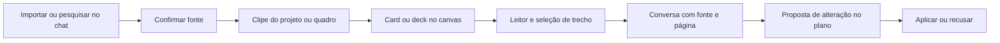

# Biblioteca de fontes nos canvases — Dynamic Diary

Data: 10/10/2026. **Estado: proposta para revisão; funcionalidade ainda não implementada.**

## 1. Objetivo e entendimento do pedido

Transformar o Construtor de Planos e o Dynamic Board em uma bancada de pesquisa: reunir documentos, imagens e artigos; distribuí-los no canvas; ler e investigar seu conteúdo; e usar trechos identificáveis nas conversas com a IA. A referência em produtos como o Notion é a experiência de acessar muito conteúdo com fluidez, sem presumir ou copiar sua arquitetura interna.

O usuário pediu um clipe de anexos integrado aos controles existentes, PDFs com capa e cantos arredondados, agrupamento em deck, leitura dentro do canvas, pesquisa pelo chat com confirmação para guardar uma fonte e persistência otimizada no Storage. Também pediu este desenho antes da execução.

Decisões propostas para tornar o fluxo concreto:

- O clipe mostra primeiro as fontes do projeto ou quadro atual. Uma ação permite reutilizar outras fontes da conta, sem expor tudo por padrão.
- Um Board tem seu próprio escopo e funciona sem projeto ou plano. No Planner, o vínculo a um nó é opcional.
- Confirmar um resultado de pesquisa adiciona a fonte ao clipe. A entrada no canvas ocorre por arraste ou pela ação equivalente de adicionar.
- O mesmo arquivo pode aparecer em vários cards, decks e contextos; suas apresentações referenciam uma fonte comum.
- Importar arquivos, gerar capa e extrair texto localmente não dispara automaticamente uma chamada paga de IA.

## 2. Escolha de arquitetura

| Abordagem | Consequência | Avaliação |
| --- | --- | --- |
| Anexos independentes em cada canvas | Entrega visual inicial rápida, mas duplica arquivo, leitor, referências e regras de exclusão | Insuficiente para reuso e escala |
| Biblioteca compartilhada com adapters para Planner e Board | Um catálogo, um serviço de assets, um leitor e contratos comuns; cada canvas conserva seu posicionamento | **Recomendada** |
| Novo gerenciador de documentos separado | Amplia navegação e manutenção antes de resolver a bancada de pesquisa | Adiar; o clipe atende o fluxo inicial |

O módulo compartilhado é infraestrutura da aplicação. A interface continua simples: clipe, cards, leitor e chat contextual.

O último caminho aproveita o sistema de propostas existente. Ler um documento ou pedir uma explicação não altera o plano automaticamente.

## 3. Experiência no canvas

### Clipe

Adicionar um ícone discreto de clipe ao conjunto atual de ferramentas, sem faixa permanente adicional. Ele abre uma janela da mesma família do Estúdio 3D e da pesquisa de imagens: arrastável, redimensionável, minimizável, com abas quando necessário.

Dentro dela: busca curta, importar arquivo ou colar link, filtros por tipo e cards compactos. Os resultados mostram disponibilidade e processamento: guardando, pronto, somente link, texto disponível sem original, falha ou arquivo indisponível offline. A confirmação de gravação precisa corresponder a uma persistência realmente confirmada.

Fontes recebidas pelo chat e pela importação manual entram no mesmo catálogo. O clipe não vira uma segunda cópia de “Meus PDFs”: essa entrada passa a acessar o mesmo acervo, com filtro de PDF. Contexto e filtro mudam a apresentação, não a identidade do arquivo.

### Card e deck

O card de PDF mostra a primeira página real como capa, com proporção preservada e arredondamento do sistema. A moldura acompanha a capa, sem uma grande área vazia em volta. Nome, ações e detalhes ficam compactos, disponíveis ao passar o mouse, focar pelo teclado ou tocar. Foco de teclado continua identificável, sem reaplicar o contorno azul forte aos objetos selecionados.

É possível mover, redimensionar, copiar e colar uma apresentação. A cópia reutiliza o documento e conserva um posicionamento independente. No Planner, a associação opcional ao nó usa as conexões suaves existentes; mover o nó não arrasta o arquivo junto.

Um deck agrupa apresentações de PDFs. Mostra uma capa à frente, duas bordas discretas atrás e a contagem. Abrir revela os documentos; é possível reordenar, retirar um card do grupo e desfazer. O deck não combina os binários em um PDF novo. Agrupar é uma decisão visual explícita; importar vários PDFs para o clipe não os espalha automaticamente pelo canvas.

Imagens usam miniaturas; links usam título, domínio e uma prévia segura quando disponível. Arquivos de texto/código podem aproveitar o leitor de texto. Formatos sem visualizador preservam o original e oferecem download, sem prometer edição nativa.

### Leitor

Um clique ou toque abre o documento em janela flutuante, sem substituir a tela do canvas. O leitor reutiliza o gerenciamento de janelas e abas, com minimizar, maximizar e restaurar a posição anterior. No modo maximizado, a barra dedicada do canvas fica oculta, como já solicitado para as demais superfícies.

PDF: página atual, busca textual, zoom, navegação e camada de texto selecionável. Ao minimizar, a renderização para; a posição de leitura permanece. Ao fechar ou sob pressão de memória, recursos podem ser liberados e recriados ao reabrir. No celular, a leitura ocupa a área útil da tela; no tablet e desktop, pode coexistir com o canvas. Selecionar texto, rolar o leitor e usar a caneta não devem mover o quadro por acidente.

PDFs escaneados continuam legíveis visualmente. Quando não houver texto extraível, a busca e a IA informam essa limitação; OCR é uma extensão posterior.

### Páginas web

A primeira entrega oferece um leitor de artigo: conteúdo extraído e sanitizado, título, autoria quando disponível, URL original e data de captura. Permite selecionar trechos, pesquisar e conversar sobre o conteúdo que realmente foi obtido.

Na primeira entrega, “Abrir original” abre o site no navegador, fora do leitor sanitizado. Sites podem impedir frames; um iframe externo também não oferece acesso irrestrito ao conteúdo para seleção pela aplicação. Paywall, autenticação, página dinâmica sem extração ou bloqueio ficam identificados. Não apresentar o leitor como se fosse um navegador completo capaz de interagir com qualquer site.

Incorporar o site original dentro da janela é uma evolução separada: requer avaliar permissão do site, isolamento, cookies e acesso de terceiros. A regra de não encaminhar credenciais no backend não controla, sozinha, os cookies de uma navegação direta do navegador. Por isso, o primeiro leitor não carrega o site original em um iframe silenciosamente.

Uma atualização da página cria uma nova captura/revisão. As citações anteriores continuam ligadas à versão lida, enquanto essa revisão estiver preservada.

## 4. Pesquisa e IA

Exemplo: “Encontre artigos sobre controle de braços robóticos com servos pequenos e limitações de torque”. O chat considera o objetivo, os nós referenciados e as fontes que o usuário autorizou para a consulta. Retorna candidatos com título, autores/ano quando conhecidos, origem, DOI/URL, disponibilidade e uma justificativa curta de pertinência.

Cada resultado oferece abrir e adicionar ao clipe. Confirmar adiciona pelo mesmo comando validado da interface, com tratamento idempotente. Se apenas metadados estiverem acessíveis, a fonte é guardada como referência bibliográfica; o sistema não afirma que leu o artigo completo. O PDF acessível pode ser preservado como original, com progresso, limites e respeito às condições de acesso. Resultados não escolhidos não são baixados em massa.

Um adapter de pesquisa bibliográfica evita prender o módulo a um fornecedor. OpenAlex é um candidato inicial; disponibilidade, autenticação, custos e limites serão confirmados na implementação. DOI e URL ajudam a reconhecer a mesma obra, mas versões distintas de um artigo não devem ser fundidas apenas por semelhança de título.

O TypeSafe pode apoiar classificações de relevância, tipo de fonte, cobertura do pedido e relação com o projeto. Essa classificação orienta a seleção e mostra incerteza; comprovar uma especificação ou compatibilidade exige o conteúdo e a referência que a sustentam. A busca precisa preservar separadamente itens diferentes do pedido, evitando repetir o caso “Arduino e cabo” que retornava apenas cabos.

Ao selecionar um trecho no leitor, ações compactas permitem perguntar, explicar ou levar ao chat. A mensagem recebe uma referência visível com fonte, revisão e página ou seção. O usuário pode acrescentar instrução e enviar. `@` deve localizar fontes e trechos, junto das referências já existentes.

A montagem de contexto prioriza o trecho selecionado, a referência explícita e o contexto pertinente do projeto. Consultas amplas ao quadro selecionam candidatos antes de buscar seus textos. Há um orçamento de bytes/tokens e um estado de carregamento; anexar uma fonte não significa enviar o acervo inteiro ao provedor de IA.

Respostas devem distinguir texto lido, metadados e inferência. Citações abrem a página/trecho de origem. Uma proposta de revisão do plano aponta a fonte usada e continua passando por aplicar/recusar/desfazer.

## 5. Modelo de dados compartilhado

Os nomes abaixo são contratos propostos, não tipos já existentes.

| Entidade | Responsabilidade | Conteúdo |
| --- | --- | --- |
| `SourceRecord` | Identidade da fonte | ID, tipo, revisões, título, autoria/DOI/URL quando conhecidos, disponibilidade e referências aos assets |
| `SourceRevision` | Conteúdo imutável de uma versão | Hash, origem/data, original, capa, texto/índice e seu estado de processamento |
| `SourceLink` | Uso em um contexto | Source ID e escopo `{project ou board, id}` |
| `SourcePlacement` | Apresentação no canvas | Source ID/revisão, posição, tamanho, vínculo opcional a nó e grupo/deck |
| `SourceExcerpt` | Trecho verificável | Fonte/revisão/hash, página ou seção, texto exato e âncora; coordenadas opcionais |
| `AssetRef` | Endereço lógico de conteúdo pesado | ID do blob, hash, tamanho e formato; resolução pelo serviço autorizado |

Fonte, vínculo e posição têm ciclos de vida diferentes. Tirar um card remove a apresentação. Retirar do clipe de um projeto remove esse vínculo. Apagar a fonte do acervo é uma ação própria, com indicação dos usos e recuperação antes da limpeza definitiva.

Deduplicação por hash ocorre dentro da conta/cofre. Identificadores aleatórios e revisão imutável evitam depender de URLs temporárias. Um novo conteúdo não reutiliza silenciosamente a âncora de um trecho antigo.

Drop e clipboard transportam IDs, revisão, escopo e coordenadas. O receptor resolve os dados pelo catálogo autorizado e valida o destino; não aceita uma URL arbitrária do payload como se já fosse um arquivo da conta.

## 6. Persistência e desempenho

### Separação dos dados

| Camada | Guarda | Carregamento |
| --- | --- | --- |
| Postgres | Identidade técnica, revisões e registros compactos cifrados com relações e referências | Na primeira entrega, o catálogo compacto compartilhado ainda acompanha o manifesto; a interface seleciona o contexto |
| Supabase Storage privado | Originais, capas, miniaturas, texto extenso/índices e cenas/geometrias/revisões 3D cifrados | Conforme visualização, leitura ou interação |
| Memória do navegador | Recursos de leitura/renderização em uso e cache pequeno | Com orçamento por bytes e liberação explícita |
| IndexedDB | Cópias cifradas para offline e diário de operações | Cache limitado, com opção de manter fontes offline |

Títulos, texto e trechos privados não viram um índice legível pelo servidor. A pesquisa inicial ocorre sobre metadados disponíveis no cliente; busca no conteúdo privado utiliza índices cifrados baixados conforme o contexto. A primeira entrega ainda baixa o catálogo compacto do cofre com o manifesto; não promete paginação remota dos metadados por projeto. O carregamento sob demanda abrange os assets pesados e os índices/textos externos ao catálogo. Um serviço de busca semântica remoto sobre conteúdo privado seria outra decisão de privacidade, fora deste desenho.

A criptografia atual deve ser preservada. Capas e índices também são conteúdo privado. O backend no Railway continua coordenando autenticação e acesso ao Storage; a mudança não transfere o backend para Edge Functions. Como o backend usa credencial de serviço, a autorização por conta precisa continuar sendo conferida nele; um bucket privado sozinho não substitui esse controle.

### Estratégias obrigatórias

- Abrir um quadro carrega seus registros e as miniaturas visíveis, sem baixar todos os PDFs, cenas 3D ou revisões.
- Abrir uma fonte busca o original sob demanda. Interagir com um artefato 3D materializa a cena necessária; objetos fora da área útil não devem gerar downloads e recursos GPU antecipados.
- Requisições concorrentes para o mesmo asset compartilham um trabalho. Fechar uma janela libera sua assinatura; o download só é cancelado se nenhum consumidor ainda precisar dele.
- RAM e cache offline têm limites por bytes, política de descarte por uso e proteção dos recursos ativos. Limpar cache não apaga o original remoto nem operações pendentes.
- Renderizar somente páginas visíveis do PDF e uma pequena vizinhança. Reutilizar thumbnails; liberar canvases, workers, texturas, geometrias e object URLs quando não usados.
- Separar original de derivados: uma capa pequena para navegação, imagem adequada ao zoom e original preservado. Reduzir uma miniatura não destrói a fonte.
- Uma atualização de posição de card não reenvia o binário. O pipeline confirma upload e integridade antes de publicar a referência; falhas deixam estado recuperável.
- Definir uma política única de tamanho por arquivo, quota de conta, concorrência e cache, em vez de aumentar isoladamente limites espalhados pelo código.

**Limite importante da primeira entrega:** o formato atual cifra cada arquivo em um envelope completo. Portanto, o PDF só é baixado quando aberto, mas nessa abertura precisa ser baixado e decifrado por inteiro. Virtualizar páginas reduz renderização/memória gráfica; não transforma isso em download por página. Arquivos muito grandes exigiriam depois um formato autenticado em blocos, com versionamento e migração próprios.

O manifesto atual também reúne muitos documentos. A primeira migração retira os payloads pesados dele e conserva referências compactas. Divisão em registros cifrados por documento/contexto pode vir em seguida, com controle de revisão e conflitos; guardar binários no Storage, sozinho, não resolve um catálogo monolítico que cresça sem limite.

### Exclusão, backups e offline

A coleta de arquivos sem uso precisa considerar referências de quadros, projetos, decks, citações, revisões, backups e operações ainda pendentes. Como as relações ficam cifradas, o servidor não pode inferir todos os usos lendo o banco. A limpeza deve depender de uma revisão confirmada do catálogo, protocolo de assets vivos e período de carência; nunca de uma listagem parcial ou cache de um único aparelho.

Backups completos incluem documentos e os blobs referenciados, não apenas URLs. Sua restauração valida os hashes e recria os vínculos. URLs assinadas ou de sessão não são endereços permanentes de backup.

Offline: cards e metadados podem abrir com a cópia autorizada; o leitor abre arquivos já disponíveis. “Manter offline” fixa fontes selecionadas dentro da quota. Arquivos ausentes mostram necessidade de conexão. Novas importações offline e OCR não fazem parte da primeira entrega; não ampliar silenciosamente o contrato offline em andamento.

## 7. Integração com o código atual

Inventário de leitura em 10/10/2026, na branch de trabalho `codex/pwa-mobile-validation`:

| Base atual | Reuso e adaptação previstos |
| --- | --- |
| `src/kb/types.ts` e KnowledgeRepo | Preservar resumos e texto legado; conectar ao catálogo. Registros sem PDF original ficam marcados e permitem reanexar. |
| `src/attachments/files.ts` e FileAttachments | Reusar extração de PDF/DOCX/texto e políticas de contexto; passar a referenciar fonte/asset, preservando tipos já aceitos. |
| `src/visuals/media.ts` e `src/cloud/vault/transport.ts` | Generalizar assets além do Planner, manter cifragem, integridade e autorização. |
| `server/vaultRepository.mjs` | Reusar bucket privado `dynamic-diary-vault`, blobs imutáveis por owner/ID e publicação após verificação. |
| `src/visuals/VisualWorkspaceBridge.tsx` e `src/boards/BoardCanvas.tsx` | Adapters para o mesmo card e contrato de drop, respeitando stores e coordenadas próprios. |
| `src/visuals/ui/FloatingPopup.tsx` e sessionStore | Ampliar tipos de janela e maximizar/restaurar, reaproveitando abas, resize, minimize e viewport. |
| `src/chat/references.ts`, chatHandoff e workspaceTools | Referências congeladas no envio, contexto validado e as mesmas ações da interface. |
| `server/publicHttps.mjs` e specDocuments | Reusar busca pública com validação de URL/DNS/redirect, limites e extração; separar infraestrutura de seu caso de uso atual. |

Problemas concretos a tratar: `CloudRuntime.mediaBytes` cresce sem eviction; `VisualCanvasLayer` prepara recursos de todos os artefatos antes de descartar desenhos invisíveis; o Board ainda possui imagens inline; `VisualArtifact` contém cena e revisões inline; KB/PlanFile guardam texto extraído sem manter o PDF original.

Os módulos novos devem agrupar fontes, assets e leitores por responsabilidade. Evitar uma implementação separada completa para cada canvas e evitar ampliar indefinidamente o componente principal do Board ou do Estúdio.

## 8. Privacidade e conteúdo externo

Downloads públicos respeitam os mecanismos existentes de HTTPS, endereço público validado, redirects revalidados, limites e cancelamento. Não encaminhar cookies ou credenciais do usuário a um site pesquisado. Páginas lidas entram como dados não confiáveis: seu texto não autoriza ferramentas nem altera instruções do agente.

A IA recebe somente o contexto do pedido autorizado. A interface mostra as fontes/trechos incluídos, sem exigir o envio integral de documentos quando uma seleção basta. Classificações, resumos e artefatos gerados continuam distintos da fonte original e têm origem rastreável.

## 9. Etapas de entrega e critérios de aceite

Estas são fatias de produto da proposta, não um roteiro de implementação já aprovado ou executado.

| Etapa | Resultado revisável | Critério principal |
| --- | --- | --- |
| 1. Fundação de fontes e assets | Catálogo/vínculos, IDs, migração compatível e retirada gradual de payloads pesados | Mesmo arquivo em dois contextos ocupa um asset original; falha no upload não publica referência quebrada |
| 2. Clipe, cards e leitor PDF | Importar, capa, arrastar/adicionar, deck, abrir/minimizar/maximizar, selecionar e buscar | Fluxo funciona nos dois canvases; remover apresentação preserva a fonte e outros usos |
| 3. Fontes no chat | `@`, trechos e citações navegáveis; pesquisa com confirmação para guardar | Resposta aponta conteúdo realmente lido; candidato não confirmado não entra no acervo |
| 4. Leitor web | Link no clipe/canvas, artigo extraído, trechos, original e revisão da captura | Bloqueio, paywall e conteúdo indisponível têm estados honestos; conteúdo externo não executa ações |
| 5. Consolidação | Cache limitado, lazy 3D, política de quota, backup/restore, retenção e ensaio offline | Performance e integridade verificadas em desktop, celular e S9 com caneta |

A base de assets e as correções de carregamento começam antes da nova interface. A etapa final confirma a integração e mede desempenho; não é a primeira vez que se considera esse requisito.

Bateria de validação:

1. Abrir um quadro com 100 fontes de teste: sem GET dos originais PDF/3D só por abrir o quadro; miniaturas restritas à região visível e à pequena margem de pré-carregamento.
2. Colocar o mesmo PDF em dois quadros, copiar um card e remover outro: sem cópia binária desnecessária ou perda da fonte.
3. Abrir, minimizar e reabrir PDF: posição preservada; renderização suspensa e recursos liberáveis; texto selecionável sem pan acidental.
4. Duas janelas usando a mesma fonte: deduplicação de download; fechar uma não cancela a outra.
5. Upload interrompido, resposta perdida, reconexão e mudança de conta: retomada idempotente, integridade e autorização preservadas.
6. PDF sem texto, protegido por senha, corrompido, grande e arquivo legado sem original: mensagens e ações apropriadas, sem falso sucesso. Entrada de senha é humana; não persistir senha do PDF em claro.
7. Link que bloqueia frame, muda de conteúdo, redireciona ou fica indisponível: leitura/citação e fallback corretos.
8. Consulta com múltiplos itens e seleção de trecho: cobertura do pedido, fontes reais, citações da revisão correta e orçamento de contexto respeitado.
9. Fonte em cache offline versus ausente, quota do navegador e exclusão com outra referência ativa: sem perda ou afirmação falsa de salvamento.
10. Teclado, foco, contraste, toque/caneta e viewport móvel: controles acessíveis e área de leitura útil, sem depender exclusivamente de hover ou arraste.

Medir tempo até a capa, tempo até a primeira página, bytes transferidos, memória após ciclos de abrir/fechar e latência de interação. Registrar ambiente e baseline antes de definir metas numéricas de produção. Nenhuma medição foi executada para esta funcionalidade proposta.

## 10. Relação com a pesquisa do artigo

O módulo ajuda a ligar uma premissa do plano à fonte e ao trecho que a sustentam. Uma fonte pode motivar uma previsão ou ensaio; uma observação física pode contrariá-la e justificar revisão. Guardar um artigo ou receber uma classificação positiva não transforma a premissa em evidência física validada.

Para o artigo, documentar separadamente desenho, implementação, testes de software e ensaio real com usuário. Usar o ciclo de `docs/OBJETIVO_DO_ARTIGO.md` como referência, sem presumir eficácia ou novidade.

## Referências técnicas consultadas

- [Supabase Storage: access control](https://supabase.com/docs/guides/storage/security/access-control) — bucket privado, RLS e limites da proteção ao usar credencial de serviço.
- [PDF.js: exemplos oficiais](https://mozilla.github.io/pdf.js/examples/) — documento, páginas, viewport e renderização controlada pelo aplicativo.
- [OpenAlex: documentação](https://help.openalex.org/) — candidato de índice bibliográfico; integração ainda a validar.
- [MDN: frame-ancestors](https://developer.mozilla.org/en-US/docs/Web/HTTP/Reference/Headers/Content-Security-Policy/frame-ancestors) — sites podem impedir sua incorporação em frames.

## Estado ao final desta proposta

Design documentado a partir do pedido e da inspeção do código. Nenhuma biblioteca de fontes, card PDF, deck, leitor ou pesquisa acadêmica nova foi implementada, migrada ou publicada nesta etapa. A integração offline em outra frente continua em trabalho e não constitui dependência já concluída.
